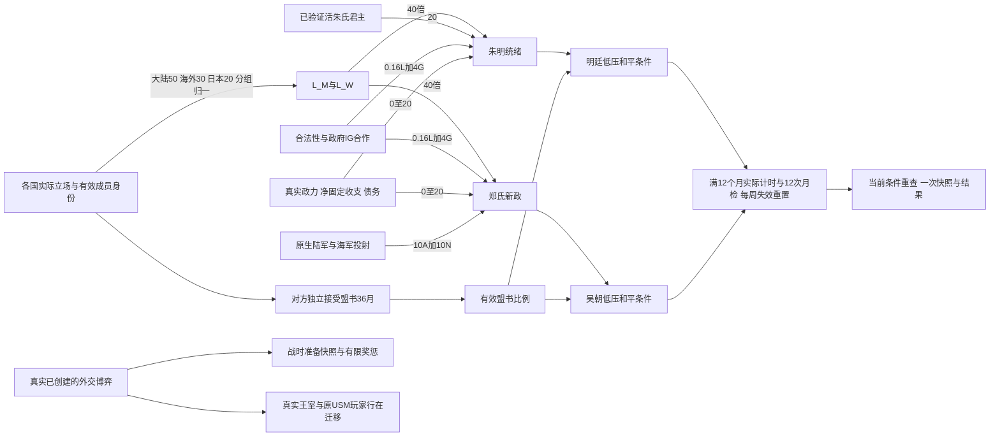

# 30 明吴诸国：当前实现与验收入口

状态：**2026-10-31，B1已冻结，原生政治分计算已局部实测；C2已冻结待实机。** 最新独立来源 `exports/south-politics-accords-20261031-b1`，父B→C1→C→A1→A→hus-pm-format-closure-A。根当前合成实机run192545包含B1+PHI A1等，不含C2/福建新图；实际组合以该run.json为准。

旧蓝图已归档至 `evidence/30-succession-blueprint-before-B1-20261031.md`。其中旧35/35/30政治权重、简单月检及旧订约按钮不得继续作为当前规格。本文件是活动规格；全部数值仍待真实平衡验证。

## 1. 已实施的结构

采用法国分派JE的“先选择路线、按现实政治经济积累、分支结果”结构。法国现存波拿巴、共和、奥尔良、波旁四线源码与相关效果/按钮/进度/本地化已读；没有照抄法国数值或共同global选择旗。

一个context=none的“南朝诸国”全局JE，国家各存互斥立场：1拥明、2拥吴、3中立、4自主，0未表态。各国的财政、兵力、船只、真实水手、准备和签约独立。全局没有国家ROOT，效果显式切到country；首批参与交由should_be_involved/immediate_all，晚加入先检查is_involved再加，避免重复注册。

现有层级：全局态势板与四立场→真实盟书接受/拒绝/撤回→两条低压和平窗口或真实外交对峙→行在迁移/复国与战争结局。和平、王室、经济准备不是同一个计数器。

## 2. 当前精确政治公式

设L_M、L_W为拥明/拥吴的有效政治分组比例（0–1），A、N分别为USM在帝国成员中的真实陆军/海军投射份额。G为政府中支持度非负的IG势力占本政府IG总势力比例；L为国家合法性（0–100）。

|量|B/B1实际公式|
|---|---|
|朱明统绪|40×L_M + 20×当前活着的已验证朱氏君主 + 0.16×L + 4×G + F|
|郑氏新政|40×L_W + 10×A + 10×N + 0.16×L + 4×G + F|
|财政行政F|政力非负+8；非违约且净固定收支非负+8；scaled_debt≤0.5再+4，总0–20|
|陆军份额A|USM army_power_projection /（USM + 当前政治成员陆军投射总和）|
|海军份额N|USM naval_power_projection /（USM + 当前政治成员海军投射总和）；分母零时0|
|诸府盟约|相同政治分组算法，仅计真实接受、未到期、未撤回且当前条件有效的相应路线盟书|

军力项是政治力量代理，**不是作战胜率或配员率**。船数、实际crew、达标舰数另显示。run192545 Apr1已缓存真实海军trigger。PHI40舰仅2000水手、2舰达标仍有6789.5775海军投射，因此必须另保留实际配员门槛；未在投射上自行再乘设计定员比例。

分组固定互斥：大陆HNA/SIH/GNG占50；海外帝国成员占30；日本JAP/JTK/JIM占20。缺席组按实际存在的组权重重归一，但核心签署/整合门禁不会因此取消。新占一块中国州不改变投票组；领土整合另用地理trigger。CNE/QE1/HUS/FRA/MUG/SHA/GBR/RUS是外部参与者，不计宗盟票及帝国军力分母；改投其他宗主的旧成员也不计。

组内代表权重：HNA/SIH/PHI/DEI/YN1为3；GNG/BUR/DAI/SIA/TRA/MYS为2；其他为1。它表示会议中的制度权重，不伪装成人口或军力。实际军队仍另算。

## 3. 国家军政筹备（与中央政治分分开）

财政0–20=F。政府0–20=0.16L+4G。供给0–25按当前资本市场：纸8、工具8、轻武器9，各须不超过基价+50%且本国无该商品本地短缺；不要求自产。

军务0–35：兵营按等级加权occupancy；舰队按实际crew_percent≥70%的船只比例。兼有陆军和船舰时分别25/10；仅一项时该项35；两者皆无为0。这个值衡量行政/物资/配员准备，不增加实际军队。原生舰数、crew、陆海投射同时展示，不能把PHI40舰7000水手写作满员舰队。

仅真实DP建立后做一次战时快照。实际参战阵营的筹备≥70给予12个月军费效率小奖励，<30给予12个月−5声望；中立/自主的声明不自动当军事拥吴。和平时只有与胜方一致且真实履约者得24个月小声望奖励，高准备者另+5；明确支持败方者12个月−3声望及关系−15，不用财政惩罚制造贫困循环。快照/奖励旗阻止重复发放。

## 4. 盟书与严格和平

USM只能为自己所选1或2路线发邀请，邀请冷却6个月，议约期间6个月政府工资+3%、权威−25。各接收国自行接受或拒绝，默认拒绝；接受36个月有效，立场6个月锁定。变派、撤约、对USM作战、改投其他宗主、到期都重算。中立/自主不是自动反吴；外部国可以观察和援助，不签帝国内部票。

双方共同条件：政治分≥85、领先另一方≥20，无本次内战、无战争、非default，政力非负，**压力<60且无declared_bankruptcy恢复期**。Ming必须中央明确拥明、真实在位朱氏君主、盟书≥75、至少两个大陆核心真实签署，以及纸/工具/轻武器当前供给检查。Wu必须中央明确拥吴、盟书≥80、至少两个大陆核心；每个拟整合国均当前有效同意、自控所交州；所有存续日本方接受秩序，只有实际持四国/九州者需要割让并保留其他自控州。另须至少一船、75%以上船crew≥70%、军舰维护履约≥75%。

观察有独立12个月到期变量，不能用12次跨月或旧变量100替代。每周/每次测量发现条件破裂即清计时；月检另计数，定案事件和最终effect均再检查。拒绝定案重新开始实际计时。

Ming和平不吞并其他国家，保留真实君主、成员领土与经济法律，中央承担10年盟约成本。Wu按明确50州地理可选范围与具体同意交接：全境在范围内且非保护海外TAG才整国并入；混合国家只交自己的指定state，先迁有必要迁的首都/市场首都；第三方交集和外国投资不被显式国有化。PHI/DEI/YN1等海外身份保留。日本只交本国四国和九州，原USM既有10格九州不算新让渡。整国并入的人类成员须本人先同意，且USM无人类玩家，实际play_as在annex之前；否则不允许该和平整合。

地理≠同意≠所有权。白名单见wu-peace-geographic-whitelist.json；原版geographic_region_china含蒙古且漏满洲，未直接使用。set_capital/market_capital采用当前794有效州生成字面映射，applied成功才割州。新增北福建并图时必须同时增加地理key并重生795映射。

## 5. 王室、玩家与当前已知缺口

C/C1兼容入口flavorUSM.4先缓存，.400为原文政变事件；实际DP之后才迁真实天子/继承人并play_as。仅原USM拥明玩家可以切国，目标HNA/SIH必须真反吴、独立、有自控首都、无另一玩家。原地方统治者保留；仅治理原则按合法君主情况调整，不复制全部USM法律。无活王室时监国，不创建随机朱氏继承人。政变前无host留京议约；DP后无host保留既成世界等待接应，不半回滚国家/市场/战争。

B收紧王室身份：八个作者USM_zhu模板或已验证王室标记，真实朱氏君主的实际继承人才继承标记；不以monarchy或姓氏一概合法化。旧不可靠标记被清理，外国现任统治者不被强抓来做吴君主。

**C2已独立实施，尚未实机：** general refuge在真实DP成立后迁移合法活王室，只有控制权切换绑原USM玩家；接收国选择拥明才奉君。真实旧地方君主用scripted other-role保留为行在保护人；无host时宗室留京并有岁费，不创人物。无战高压可在其余严和平条件全部满足时承担政府工资+5%、权威−50，实际满1月后每次有效月检压力−3，至40结束；仍须B1十二月观察。僵局满24月可明确无胜者收尾，不吞并/发胜者奖励；每周和月检发现条件失效即重置计时。外部观察者不再显示四立场按钮。详细闭包/未验收矩阵在30c2计划和court-reconciliation-c2-engine-checklist.md。B1活动run本身不含这些修复。

## 6. 证据、可达性与下一步

B冻结：468文件，27差异，父C1，backup candidate-south-politics-b-20261031T191855Z。B1父B，4差异，backup candidate-south-politics-b1-20261031T192433Z。静态无新增error；B多widget有一条Tiger schema warning，当前原版00_meiji_restoration.txt:10/16本身使用双widget，实际显示仍待验证。地图/history/素材/人物模板未改。

Feb5真实存档：陆军份额0.3193609；USM260舰169000/169000水手，PHI40舰7000/26000、仅9舰达到70%。原生海军投射尚未缓存，设计属性探索代理给军事项约11.8255，不能当实测。代理下全联盟/财政/政府合作满分时，合法性56的Wu得84.7855，58得85.1055；说明85有可达窗口，仍需要实际海军trigger和长期经济运行验证。算术证据south-politics-b-arithmetic.json、south-naval-capacity-native-Feb5.json。

最小实机矩阵见south-politics-b-engine-checklist.md。先实际选择立场、双方签署、检查scope/国别与压力/破产反例，再用仅计时夹具测试生产守卫；不得写winner/committed代替条件。最终要自然12个月样本、到期/换宗主/破约、混合领土/日本/人类整合、王室生死与读档、AI政治变化及经济回归。静态通过不等于以上已完成。

## 7. 追加的原生实测与 C2 验收边界

run192545，1836-04-01原生存档：全球JE79唯一、45国参与；明53.28，吴76.31426，盟书54.8213，压力2。USM陆军投射2820.96578/帝国总9523.31339，海军44585.385/总51581.807。独立Decimal逐除法按1e-5截断复现军力11.60570及三项政治分，证明这批数据的公式和作用域相合，不能证明所有分支或长期平衡。来源politics-phi-native-192545-Apr1.json、south-politics-native-Apr1-formula.json。

USM226/260舰达到70%crew，149000水手；PHI2/40舰达标、2000水手。其general筹备73.0202不等于PHI专项恢复任务（当时仅1/4、20兵营与作者35营不符）。通用政治代理、原生作战状态、特殊日志目标分别验收。

C2待验收部分：外部按钮真实隐藏，AI/人类原国与接收国的同人物迁移，原储君离开吴序列，地方保护人可见，死亡/读档/重复派发，行在皇帝称号，实际一月成本，破约停止与重开等待，连续24个月僵局收尾。原版日本天皇角色使用type=other，Tiger1.19.0枚举漏此值，C2新增宗室/保护人产生两条有源码支持的诊断；仍须引擎角色验收。

C2冻结记录：exports/court-reconciliation-20261031-c2，父B1，23文件差异，backup candidate-court-reconciliation-c2-20261031T200537Z；独立review无剩余静态阻断，详见court-reconciliation-c2-static.json与engine-checklist。周检查只保证检查点可观测的条件失效会重置，不能声称亚周瞬态已严证。
