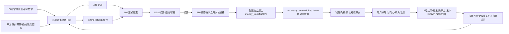

# 36 吕宋：驻屯军费与有限自治（候选，未实机验收）

2026-10-31，1.13.11 / build 24799966。父版 `exports/hus-pm-format-closure-20261031-a`。本模块独立于当前 run180905；不修改主 MOD、冻结副本、人口、地图、开局建筑或作者军队历史。

## 事实、危机与设计理由

作者 `replace/ce_country_flavor_text_l_simp_chinese.yml:22` 将林则徐写为受郑氏排挤的朱班博门生、原湖广长官；`ce_usm_events_l_simp_chinese.yml:204` 写“一半楚军南渡吕宋”。35营吕宋西府驻屯大营因此是流亡政治集团与军事资产。不能把 AI 裁掉其大部判作经济恢复。原版 `06_military_formations_asia.txt:509–545` 另外叠加了7营菲律宾陆军；这是真实继承遗留，但尚未获证其符合故事。本候选保留二者，不借修财政偷偷删除作者或原版历史编队。

run180905 Feb5（USM玩家自然推进，PHI此前为AI）实测：收入7,516.45、军费10,295.51、贡赋1,642.80、总赤字5,793.60/周；无建设；储备80,753.79、无债。军队已由42营降至36，海军行政楼15→7，40舰的船员从15,000减至7,000。旧季度和年度档最终只保留12营、1–2所海军楼，不作为成功对照。完整数据见 `evidence/sih-phi-fiscal-recovery-audit.md` 与 `sih-phi-native-longitudinal.json`。

**新增反证：舰数不是可战海军。** 当前 `common/ship_types/00_ship_types.txt` 战列舰基础船员800，护卫舰500；20+20舰基础需求26,000。原作者15所simple sailor recruitment各1,000名额已不足满员。B留下20护卫也需10,000，绝非2所或5所便足够。改装/战损还可能改变实际需求；引擎 `total_crew_needed` 与每舰 `crew_percent` 是验收依据。A的8k只能作为可测试报价，不能据Feb5残编财政宣称充足。

## 两路合约与机会成本

|路线|双边承诺|PHI首轮账面估计|USM机会成本|政治含义|
|---|---|---|---|---|
|A 驻屯军费协定|8,000/周12个月；原生decrease_payments，基础贡率25%→15%；不转船，不删军|在Feb5残编规模约+2,863.52/周，随后招募船员/物流会增支|钱款416,000/52周，按当前税基少收34,170/年；当前55,397周结余约降至46,740，未含新变化|须先有B模块真实签订且立场一致的拥明或拥吴盟书；两方都可，不能让林则徐自动拥吴|
|B 海防分任协定|20艘实际战列舰转归USM；20护卫留PHI；减贡+原生免役；3,000/周12个月|转船前约−2,136.48/周，转船节省及补齐护卫船员须实测|钱款156,000/年+少收贡赋约34,170+受领舰队的真实工资/物流/船员|有限自治，可以中立或自主；不替其签拥吴盟书、不创建独立国家、不删除驻屯大营|

贡赋估计依据实际税项+铸币6,571.19×25%=1,642.80。条约援助是否进入贡赋税基必须看引擎，不能只凭此相等认定。不能把“舰船移交”当无偿消失的军费，接收方获得船、也承担船员与维护。B是减轻远洋义务的可恢复路径，不承诺孤立自治立即盈余。若实测35营+20护卫仍不能维持，后续审议应重新分摊义务、税制和建设；不能无条件继续削军。

12个月是钱款条约本模块主动撤回的期限；`binding_period`和原生pact `forced_duration`仅是最低约束期。减贡/免役继续遵循原生外交系统，钱款到期不删除这些pact，也不删除双方既有其他条约。拒绝和搁置不付钱、不转船、不改政治立场。原储备提供短期缓冲，议案双边确认后第一周真实入账；没有未经双方同意的自动救济。

## 状态与依赖图

`nesnd_phi_*`独立命名，不写B的政治盟书变量。A只读取存在且有效的 `nesnd_south_accord_active`、side与PHI及USM双方当前stance一致、未broken；B不用政治盟书。父版本没有B帮助函数，因此不调用尚未定义的函数。B作者复核指出：原盟书可保留为反对派政治承诺，但USM改拥吴后不应继续据拥明盟书索取同派驻军8k；已据此补双方立场一致条件，履约期间也每月核验。

阶段0闲置→1已提案→2USM核准→3创建中→4有效。提案120天失效；拒绝90天冷却；搁置30天冷却。最终确认再次检查双方存续、直接宗属、同一市场、无双方战争、路线资格、20艘可转战列舰、原生条约/pact许可与付款方负担。仅本次 `_creating` 标记、双方、money_transfer方向与数量匹配的 `on_treaty_entered_into_force` 才绑定typed treaty变量。创建失败不会发船/减贡。

到期主动结束钱款，提前自愿撤约显式 `apply_break_penalties=yes`；关系不再符合（市场/宗主）按受款方退出处理；双方开战不擅自判侵略责任，终止钱款不额外自造惩罚；亡国只清本模块。默认拖欠会标履约失败而非悄悄充作入账。外部取消条约由每月实际in-force枚举识别；绝不枚举删除双方所有条约。付款方镜像保存ID和期限，以免PHI灭亡后无法清理。

实现已补精确12个月隐藏事件，事件保存本次合同序号；旧合同延时事件不能结束后来续签的合同。月度与付款方期限检查作为补偿处理。原生改订若在同一ID添加其他条款或改变钱款数量，停止接管该约并通知依新约核对，而不撤回夹带的新条款；改订属于外部新承诺，不虚报旧专项已经删除其钱款。原生撤销减贡/免役会中止本合同并按付款方撤约处理，不将失信算到PHI名下。

## 玩家、AI与恢复判据

按钮给两种实际请求；AI以赤字、可签约条件、真实政治盟约与舰队数量选择。USM的接受还要求真实正财政余量与储备，战争/违约和经济紧缩时可拒绝或暂缓。不会开局强制USM出钱。后续重新申请须重新双边同意，不隐性自动续约。

恢复进度分别检查：持续非违约且非破产的非建设财政；至少35营保全；A至少40/B至少20艘存活舰的船员至少75%且海军维护履行至少80%；失业和欠食不越危机警戒线。3个月持续只是财政巩固显示，最终完成需本专项钱款终止之后另持续3个月；也允许提前退出而自行恢复，退出的违约代价照常保留。无战争/征服或条约进度免费战斗奖励。维护、就业阈值是待实测设计口径，不是一般国家经济合格线。

AI经济会自行调整，不把脚本愿望当保证：一旦AI依旧裁军，候选失败。下一步可以依据真实缺口调整义务/AI军力目标，但不能凭常量制造名义舰队、免费官署或无限补贴。重启建议在Jan1完成协议以测开局完整规模，而非只给Feb5已裁军局补账。

## 实机门禁（全部尚待）

1. 冷启动日志新增错误为0；PHI/USM悬停，第一次JE激活/首次计数不报未知variable。
2. Jan1、Feb5两套基线：两路提案/拒绝/暂缓/PHI撤回；USM接受后但PHI确认前改变宗主/市场/战争/舰数量，再确认必须安全失效。
3. 原生 `can_create_treaty`：USM有central_banking但PHI没有，确认资格；减贡、免役DLC和宗属条款许可；不能移除预检强行通过。
4. 建立后确认独立条约ID、方向、8k或3k数量、双方每周预算与税基、最低期限。额外放一份既有USM–PHI条约，证明12月清理只删除本ID。读档后再测。
5. B前后比较20艘具体ID、owner、fleet、supplyhub、crew；全球舰船数不变、PHI护卫保留、接收舰队清理完成，舰员不能复制。实际crew不保证跟船永续，需招募和工资。
6. A完整35营+40舰满/75%船员，B35营+20护卫75%船员：记录军费各项、储备、贡赋、行政、舰员/船坞/物流维护、粮纸武器价格、就业和生活水平；走季度/年度/钱款结束后季度。USM同步核算可承受性。
7. 保存/读档、条约手动取消、双方第三国战争（不应自动断援）、双方互战、独立/换宗主/出共同市场、USM或PHI灭亡、付款default冻结、政治盟书改派/到期，各留事件、钱款和遗留状态证据。
8. 完成日志不能仅因AI裁到12营或40艘空壳而通过。不能把静态parser/Tiger通过称游戏正确。

## 真实源码索引

`common/treaty_articles/05_transfer_money.txt`、`31_ship_transfer.txt`；原版Afghanistan事件 `events/soi_events/00_ep1_afghanistan_events.txt:480–527`；`common/on_actions/00_code_on_actions.txt:3408` treaty根scope；`33_subjects_decrease_payments.txt`、`34_subjects_exempt_from_service.txt`；engine-docs-1.13.11-20261031 effects `create_treaty/withdraw/set_ship_owner_multiple/clear_ownership_transfer_fleet/ordered_scope_ship`，triggers `can_create_treaty/can_create_diplomatic_pact/any_scope_article/binds/is_fulfilled_by/crew_percent`。

## 实施与文本复核记录

- 候选 `exports/phi-imperial-service-20261031-a`；10个新增文件，父版既有文件仅metadata名称变化。主MOD/父版地图、人口、建筑、军队、原有剧本与媒体逐文件哈希保留。
- 引用原生 `ep2_active_shipyard`，实际alias在 `gfx/media_aliases/media_aliases.txt:671`、原版巴西海军事件使用；未复制工坊或创建新媒体。选用船厂场景避免先前临时的非洲殖民施工图，实际画面仍待实机检查。
- `ce_usm_events_l_simp_chinese.yml` 的作者标题“靖难兵败”、第一人称“被迫携带着一半楚军南渡吕宋”与候选“吕宋军饷”“海船归属”对照：保留楚军的流亡政治背景，财政事件用呈册、核拨、签押具体动作叙事；不平添“反对者则问”或无关转折。不让已故林则徐在多年后必须亲自签约，现行事件主体采用宣慰司。
- 作者法国日志把叙事放reason、进度条用 `JournalEntry.GetCurrentBarValue` 和颜色、条件用concept与直陈（如“[concept_bureaucracy] < #b 0#!”）。候选同样拆成reason、status、两条bar及button tooltip；金额、35营、船员比例和违约条件留在功能说明，不伪装成小说角色解释机制。
- 候选只提供简中原文；English locale使用明确未翻译的中文fallback避免raw key，不称已完成英语翻译。文本仍为待作者审读候选，不称通过了用户风格验收。
- Tiger1.19.0目标1.13.5。新增模块仅余 `total_crew_needed` 一条未收录报告；本机1.13.11 `event_targets.log:1390–1394`明确country→value支持，保留此源码反证并等待引擎实际读取。不为追求静态零错误删掉实际舰员指标。其余新模块语法、本地化、编码告警已清。

## 独立复核后的两处窄修与首要拒交付条件

names_and_testing指出：同ID/同金额仍可能通过原生改订延长binding。现已保存签约原始binding_period，月度身份检查要求一致；入约hook识别原ID或 `amended_treaty` 而移交原生管理；到期时若remaining_binding_period仍>0不替新承诺撤约，避免对USM错误施加毁约惩罚。

另加capture单条款、pending、双方关系、路线与报价（B还复查实有20战列舰）保护，_creating仅在create调用期间开放，返回时清除。**这依赖真实hook同步，尚未认证。若引擎实际先创建成功、后异步执行hook，会留下未绑定的钱款；`nesnd_phi_creation_unbound`是明确失败标记，不能把它当安全回滚或已清理。** 下次QA必须先真实签一份B，在同tick核绑定treaty/active/20船，再走下一周预算；失败即拒绝整合交付，须先取得引擎异步身份绑定办法。静态门禁不掩盖此风险。
