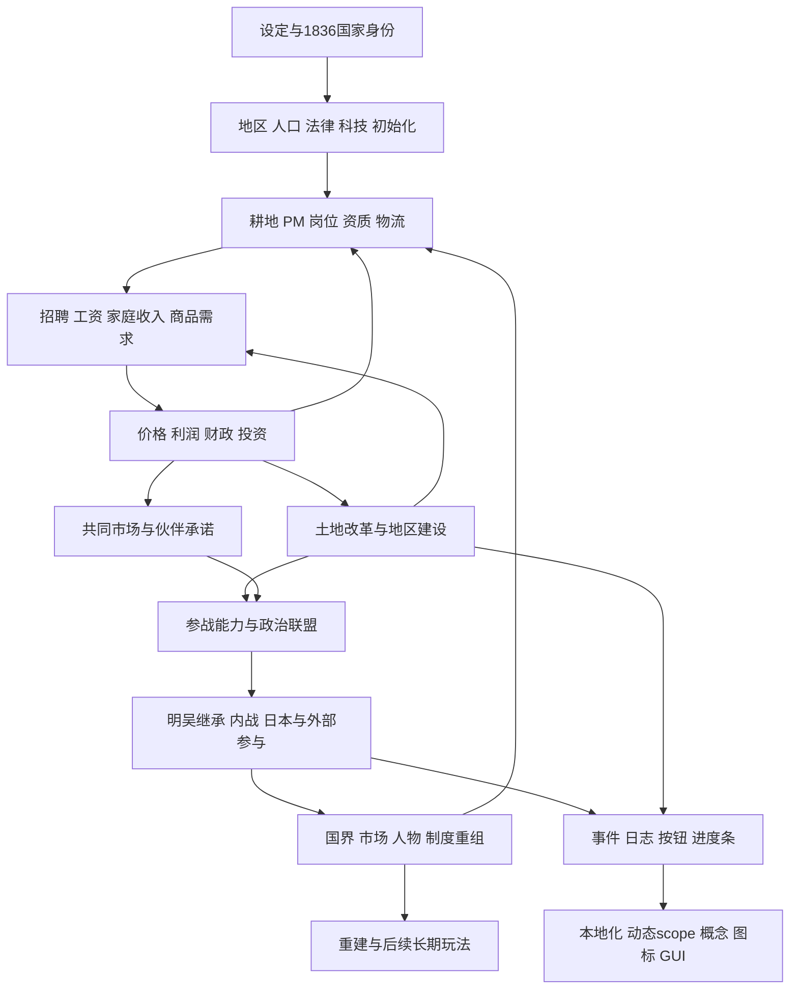

# 两朝及属国：系统设计与执行主计划

当前入口更新于2026-11-01。主MOD已经整合既有地图/发型/日志与南朝战争修复；本轮继续实施中华帝国改革子日志。最新事实以[项目任务13](<D:/Users/Eric Liu/Documents/Paradox Interactive/Victoria 3/mod/Neo-Era Southern and Northern Dynasties/.scratch/debug-release/issues/13-cne-subjournals.md>)与SKILL/references/active-work.md为准。用户自行实测，代理不开游戏；静态验证与引擎验收分开。

- [中华帝国三个子日志实施](20261101-cne-land-subjournals.md)：已实现与外部核验。
- [南朝立场、遣使与密使](20261101-southern-allegiances-envoys-plan.md)：详细计划已写，政治重构尚未实施。
- [原始范围账](12-scope-ledger.md)、[旧批次计划40](40-batched-debug-and-delivery.md)继续保留欠账与阶段记录；旧“主MOD尚未合入”等描述只代表旧候选阶段。

更新前完整主计划：[历史快照](<D:/Users/Eric Liu/Documents/Paradox Interactive/Victoria 3/nesnd-workbench/reports/cne-reform-subjournals-20261101/plan-before/00-master-plan.md>). 下方原始系统设计保留。

## 目标：发展有起点、转型有代价、胜负有后续

1836的两朝都应具备正常运转的税收、行政、必需品和军事供给。大量自给农是经济结构的一部分，不自动视为失败。北朝继承共和改革与帝国重建，重点是土地权利、就业转移、北方交通及教育；南明中央由郑氏控制核心财权军力及海外体系，强于地方，但依赖政治妥协和跨区供给。属国能从共同市场成长，同时有独立利益。没有预先完成全部工业，也没有用任意永久增益制造无敌国家。

玩家的主要决定应相互关联：先改善教育、物流或财政，扩大哪些产业，如何处理土地和失业家庭，是否负担援外或统一战争；南方决定哪些伙伴值得让利、哪些军队可信、殖民地是否继续承担帝国成本。后续危机检验这些准备，结果改变长期市场、制度、人物和发展机会。

## 有向依赖与反馈

图中经济反馈须用引擎时间验证。脚本文件关系另由 `evidence/dependency-graph.json` 记录行号；高连接标记不等于“应当增加效果”，而提示初始化、写入、读取和清理必须一起核查。

## 分支与实施顺序

|顺序/分支|负责的玩家问题|前置输入|产出/后续|
|---|---|---|---|
|[01 地图](01-map.md)|在哪里经营、扩张、分裂|设定、像素、既有边界|地区与交通→02/03/04/05/07|
|[02 人口与转型](02-population-transition.md)|从何谋生，如何进入新职业|初始化、耕地、法律|人口承载和资格→03/04|
|[03 经济与市场](03-economy-markets.md)|哪些生产能负担国家与家庭|01/02、PM与真实需求|开局与中期产业→所有国家JE|
|[04 北朝改革](04-land-reform.md)|改革如何改善生活并积累国力|02/03、原文与历史|成功/妥协/共和起义/割据→08/10|
|[05 明吴内战](05-southern-crisis.md)|强中央如何更替，地方如何选择|03/06、人物生命周期|不同胜者、市场分裂与重建|
|[06 地方和殖民地](06-subjects-colonies.md)|合作、准备自立、维护自治|03、现有条约和所有权|供给伙伴/军政准备→05/07/08|
|[07 日本](07-japan.md)|统一、独立、干涉与分割|05/06、现有政权人物|既有州上三政权及吴直辖的可变结局|
|[08 外部参与](08-foreign-relations.md)|干涉能得到什么、承担什么|03/04/05、外交和军需|有限参与与区域后果|
|[09 展示与文风](09-presentation.md)|玩家看懂什么、故事如何成立|各分支已确定的状态与作用|分类文本/图标/动态显示|
|[10 验收与发布](10-validation-release.md)|这些承诺是否真的发生|每个候选的全依赖闭包|实际运行、回归、合入与成功备份|
|[11 简易地图编辑器](11-editor.md)|用户能否安全试造另一历史|已证实的地图迁移和测试接口|可审阅差异、守恒迁移、独立试跑|

01/02消除上游数据错误，03形成同一经济基础。04—08的门槛数值依赖该基础，但其人物/国家关系、状态机、地图引用和已有调用链缺口同步推进，不能全部搁置等北朝完成。09随各分支同步，10贯穿全程；11复用实际稳定链路。具体实施与证据状态分别登记，不把计划阶段当实现完成。

## 全程国家体验矩阵（设计预估，非模拟结果）

|国家/群体|1836—1838开局|1838—1850转型及危机|1850—1870重建|1870—1936延展|
|---|---|---|---|---|
|CNE|盈余国家、大量自给农、改革和识字基础；地区承载不崩坏|土地权利与转岗；河南河北重建；财政教育物流决定能否南下|成功者扩大国内需求和工业；妥协者保留地方障碍；失败者统一/共和复兴|能转福利与高生产率经济，或保留农业帝国；无永久自动成功|
|USM/吴|中央军财强、沿海制造与殖民网络；王室仍有名分与人脉|陈东阳、郑氏继承、地方及海外承诺；继位/妥协/内战|吴胜重建与日本选择；朱明保全走联邦妥协；地方胜者重定秩序|市场与政治安排留下不同工业贸易路线，战争胜利不抹除伙伴权利|
|HNA/SIH/GNG|各有既存经济、财政可运行；共同市场带来成长机会|教育/军需/交通/伙伴准备，选择拥吴、保明或自治|战后恢复供应、处理军队与王室，赢得自主但承担国库成本|内陆工业国/联邦成员/地区强权，仍需建设与外交|
|殖民TAG|本地人口阶层、产业所有权、贡赋和港口|索取让步、保持忠诚、趁机独立；不同资源角色|留在大市场或另建联系，外资与自治矛盾继续|能摆脱单一原料经济，也可成为商业/资源国家|
|日本|州界保留；政权和吴占地决定目标|摆脱控制、参与战争、统一，或遭吴镇压|统一日本/独立诸国/三政权加吴直辖均有明确玩法|不同政权竞争统一与经济改革，不因一个事件永久停止发展|
|QE1/HUS/MUG/FRA等|自己的内政与目标仍优先|只在有土地、航路、资本、盟友利益时介入|兑现承诺或应对失败；影响两朝而非被两朝吞掉全部玩法|回到各国长期目标，保留债务、关系、领土等真实后果|

## 统一判断尺度

开局观察周/月/季/年；危机按状态而非死日期；重建至少战争后1年/5年；长期采用有代表性的成功、妥协、失败分支和AI运行。各阶段共同记录预算分项/储备、全国政力与地方税容、失业/自给农/职业资格、家庭财富与生活水平、必需品/工业投入价格、物流、市场成员、人口增长、政治势力与军队供给。工作表中的设计预期与实测值分列，不能把计划目标当已测数据。

早期不追求零自给农或零一切贫困，但不能默许初始化错误导致大批家庭财富1、地方失业不可吸收、全国税收瘫痪。转型中的失业需要就业入口或真实可负担的救济，不能只用SoL modifier隐去。晚期奖励建立制度和机会，不永久凭空发消费订单、利润和军力。

## 变更与失效记录

- 2026-10-31：新增本目录与依赖工具；既有单页实施清单保留作历史，当前计划转到此处。
- CNE人口初始化目标错误：地图几何证据仍有效；CNE/USM默认玩家经济、资格及改革门槛要在修正后重测；其他国家仅当共同市场价格或外交依赖受影响时回归。
- 尚未实施的新剧情路线不得写成“已完成”。每个分支计划底部更新证据、当前步骤和剩余项，交接文件只保存入口和最关键阻塞。

## 西秦与唐衣大食实施（2026-11-02）

新规格与完整状态见 `20261102-qin-persia-implementation.md`、WORK/reports/qin-persia-20261102/release-notes.md及主MOD任务16。12个JE及事件/按钮/文化/战争闭包已完成外部检查；ENGINE_NOT_RUN。旧国家体验矩阵保留作总体计划，不将本次范围外南朝新概率/密使标作完成。
