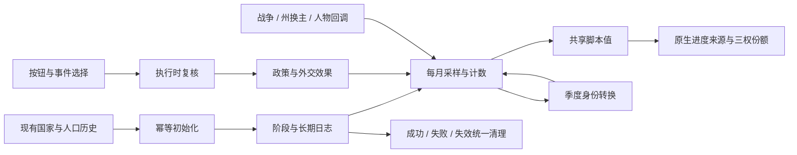

# 西秦：西部帝国的自救、文化团结与三权政治

日期：2026-11-02。状态：**实施方案，尚未实现本方案的新玩法**。本轮另行修复的波斯朝贡初始关系、CNE界面与波兰BUG不等于西秦完整内容已上线。主基线044de73；本机Victoria 3 1.13.11 / build24799966；不开游戏。

## 1. 证据与原设定边界

依据[设定与原生接口核查](../../reports/rules-poland-qin-20261102/qin-canon-api.md)、[文化清点](../../reports/rules-poland-qin-20261102/qin-cultures.md)、原始replace与本轮用户要求。PPT SHA与提取缓存一致，报告保留slide/paragraph；故事中的选择与系数都标为游戏方案，不冒称原作者唯一未来。

- PPT第13页：秦残部退守伊犁，皇族仍欲东征，军士与武勋集团畏惧再次失败。因此“军队统治派”不能简单写成人人要求立即东征；他们首先要守军饷、军府与既得权力。皇室反而可能为了恢复祖业推动冒险。
- PPT第3、21–22页：秦国具有商贸、殖民、军府与地方自治的复杂传统；波斯通过商业和技术改善矛盾、扩大自治，有历史依据。
- 第28–29页的未来线有华秦和解、边疆交还。方案保留东征统一，同时允许复兴后经营中亚或与中华帝国和解。
- 1805/1810革命起点、1821兰州与现版介绍1822敦煌存在异文。开局用“大革命之后”“退守伊犁以后”，不强造唯一日期。
- 当前首都STATE_ILI是**伊犁**；STATE_JETISY是**西益**。不能倒置。
- 现有君主陈戊兴、继承人陈矗国来自真实character template；未来死亡、退位与政变按存活角色，不复活固定人物。

## 2. 1836数据基线与“哪些文化被消除”

现版西秦直接统治36州，create_pop.size总和39,713,582，35种文化、22种heritage。三种主流文化合计65.46%：西域汉羌32.25%、西北29.40%、老秦3.82%。这些是脚本初始人口，不是本轮运行存档，也不包括波斯、卡拉特或莫克兰人口。

原版地图与现版拆州用province ID对齐：53个原版substate完整覆盖，2个部分覆盖；不按面积比例虚构文化人口。重要结论是**地区替换很多，全境完全消失很少**。例如：

- 乌兹别克人口在拔汗那、内花州、药杀水及多处阿富汗对应地区不再存在，西秦其他地区仍有313,525。
- 维吾尔人口在准噶尔／伊犁、大沙海盆地／西天山、西益、葱岭等对应地区缺席，但黠戛斯仍有12,000。
- 哈萨克、吉尔吉斯、蒙古、俄罗斯、鞑靼、华北、塔吉克等在一些对应州消失，均不能称全境删除。
- 完整对齐区域中的满文化人口，现版QE1全境为零；尼泊尔只涉及部分覆盖比较，不能据此给出精确被替换人数。
- 从最初MOD f18b6c4到044de73，QE1文化集合没有新增或删去。原版与MOD差异是作者既有世界设计，不是本轮文化修补。

逐州与所有群体见文化清单及JSON。西域汉羌的代码是ce_xiyu，heritage_uighur、language_xiyu_mandarin、tradition_sinosphere，且已经是主文化。它是已有融合文化，不应被简单视作尚未汉化的外族，也不能把它的传承字段当成每一个人的真实祖源。

波斯：044de73里PER是独立国家，旧诏只有防御、投资与贸易条款。本轮用户明确将其修正为QE1朝贡国；方案此后以朝贡关系为基线。波斯仍保有自己的领土与人口，只有直接吞并才改变QE1直接人口组成。卡拉特为直接dominion，莫克兰是其vassal；KAZ朝贡有存在条件，目前无开局领土。

## 3. 玩家主线与日志层次

|阶段|日志与剧情|玩家行动|完成与失败后果|
|---|---|---|---|
|开局|**西部帝国的自救**：退守后的财政、生产与军府争权|整顿军饷、恢复农工商、改善交通与学校；或接受军府代征与军事戒严|经济安国取得可持续税源；军管获得短期控制但提高军权和征役压力。战争失败、破产、长期失序允许进入危机，不自动补齐产业或资金|
|贯穿|**帝国文化团结**：繁荣归化与地方身份复归|学校、平等或差等权利、军役安排、地方任官和投资影响实际民生|一个0–100的持续量；跌破预警线后才出现相应地方事件，开局不预告具体叛乱|
|贯穿|**伊犁的朝议**：皇权、地方士人、军队的议价力量|法律、执政联盟、军制、任官、教育及财政选择|三方相对份额总和100，另有独立政变危机；军权大不等于已反叛|
|中期|**波斯封贡**：朝贡、贸易权与地方自治|维持宗属、协商贡赋与商业权利、加强控制，或接受自治换忠诚|保有朝贡是可行目标；吞并只是高风险路线。旧条约1811年起30年binding period只代表约束期，不能写成1841自动失效|
|中期|**再入印度**、**北方边防**：莫卧儿和俄国边疆|有限战争、贸易、属国、军府治理、殖民迁入|战胜有声望；直辖新人口增加整合负担。保留秦俄合作或边界协定，不能把每条线强制写成吞并战|
|长期|**玉门以东**→**重返关中**→**华夏之争**|先有经济与军制基础，再选择恢复河西、关中，最后争夺统一|分阶段目标、实际持有土地与战争结果结算。与CNE和解、长期中亚国家、军政帝国、宪制复兴均有结局|

每条日志只承担一件事。主线叙述处境，按钮显示行动条件，原生进度条展开来源；不把所有阶段、边界和失败剧透塞进status。玩家状态按first_valid/triggered_desc更换，一条状态最多交代当前主要处境。

开场正文的试写已按独立技能完成原文→首稿→对照→返工→修订：[试写报告](../../reports/rules-poland-qin-20261102/writing-skill-trial.md)。修订提案如下：

> 秦军残部退守伊犁以后，陈秦皇族仍时常东顾玉门，军士和武勋门阀却已不敢再提东征。西秦要继续同俄国、波斯和莫卧儿争夺西亚的霸权，就得从田地和市镇中重新取得维持军队的财力。
>
> 朝廷准备减轻农民的负担，招徕商旅，以恢复生产和税收。军士要求把各地征收交给自己的官员，武勋门阀则要把恢复的税款优先拨入军中。

第二段是本次提案，不是PPT已经写过的事件。

## 4. 文化团结：收益短、治理成本长

### 4.1 指标分开

- `P`：真实主流文化人口占比，使用primary_cultures_percent_country；西域汉羌计入。
- `H`：有显著人口的**非主流传承**数量。初拟只有达到全国1%的传承才计一整项；少数移民不等同新吞并一大片人口。另保留所有文化/传承的只读统计。
- `C`：实际有显著人口的文化种数，参与地方行政协调成本与地方士人的权力计算，不用35个数据库键无差别扣35档。
- `U`：文化团结0–100，是政治认同与治理状态的积累，不是直接复制P，更不是族群价值高低。
- `S`：州生活水平趋势，过去六个月同州比较；新取得州先观察六个月，避免吞并穷州使全国均值下降后误写成所有旧居民变穷。
- `L`：实际征召压力，用army_size_including_raised_conscripts减army_size等已证接口作代理；不把潜在可征召营当已在役人口。

### 4.2 初拟月度公式（待调平，不写入永久skill）

|来源|候选量级／月|目的|
|---|---:|---|
|国家秩序基础|+0.20|不要求开局必然崩溃|
|主流文化占比|`0.5 × (P − 0.65)`|当前65.46%接近中点；扩张稀释P，归化提高P|
|学校／警察／医疗|每级+0.04／+0.02／+0.02|机构帮助整合，仍承担原生真实行政支出|
|非主流显著传承|每项−0.05|体现多重地方身份的协调成本，轻于持续衰退或征役冲击|
|六个月生活水平持续改善／下降|+0.20／−0.30|经济安国的核心长期来源；无明显变化则0|
|行政承载|有余力至多+0.10；严重缺口至多−0.80|用余额与产出／使用量区分，不把余额当总行政实力|
|严重实际征召|至多−0.60|只在真正动员期间累计，复员撤回；具体归一化先核原生满编和动员时点|
|重要军事胜利|+0.25，24个月|一次战争只认一次，有限期声望，失败可反向打击|
|新增领土威望|+0.10，12个月且不按每小州叠加|符合新领土能提振团结，但不无限刷占领|
|新征服整合负担|0至−0.60，随新直辖非主流人口比与行政不足变化|持续时间长于威望；治理、民生和整合能逐步消除|

0–100量程下，每月0.25意味着两年约6点，具有可见但非瞬间翻盘的效果。以上每项都需记录量程、来源、期限和与其他项的净效应；不能直接拿本表当已验证平衡。

**会不会越打越不团结？** 可以，但不是无条件。边防胜利而不大吞并，主要得到短期威望；吞并大量人口而制度、交通和生活没有跟上，长期净消耗应超过威望。建立朝贡或贸易联系不把对方人口算进QE1直接文化分母，换来较低文化治理成本、较弱直接征税与兵力控制。若经济、机构和行政同步改善，扩张也能被吸收。

预警可先试60/40/20三档；达到低档并持续若干月后才出现地方请愿、军府扣饷、身份复归乃至分离。不要每月随机必出灾难；同一州使用冷却与已经处理标记。国家团结为零可以产生政权/地方解体结局，不保证自动救回玩家。

## 5. 同化与“复归”的可行实现

原版`change_pop_culture = { target = cu:... value = ... }`支持按人口群比例转换；伊比利亚、菲律宾和属国文化外交有完整实例。它不提供已经证实的逐人祖源追溯，不能声称知道每个西域汉羌人口原来是哪一族。

### 5.1 第一版采用地区身份复归

1. 每个适用州登记**明确的候选身份**，依据作者设定、现版人口和原版地理对照；原版缺席只作线索，不能批量恢复原版人口。
2. 繁荣方向：本州生活水平高于自身观察基线并持续六个月、没有严重征役压力、政策允许时，从指定当地文化人口中每季度转换小比例到西域汉羌。初拟0.25%/季，强力政策至多0.5%/季。
3. 复归方向：仅从西域汉羌抽取；在本州经济持续下行且征役高压时，按已登记地方身份分配小比例。初拟0.5%/季，极端危机至多1%/季。同一州同一季度只能走一个方向。
4. 保留人口总量、宗教、职业与现存建筑；不创建补偿人口，不把老秦／西北自动纳入复归池，不因heritage_uighur把所有汉羌都改成维吾尔。
5. 各文化转换后重新计算占比，再让U和三权读取下一期样本。避免“读一半旧人口、改一半新人口”的顺序依赖。

候选地区组：内花州、药杀水、拔汗那可研究乌兹别克/塔吉克/土库曼身份；七河、西益与草原边区可研究哈萨克/吉尔吉斯；天山绿洲可研究维吾尔与当地混合身份。**这些是待作者地理设定核定的映射，不是自动承认每个汉羌人的祖源**。满文化的原版驻军缺席不构成把当地汉羌改回满文化的证据。

### 5.2 若以后要求严格只回转本系统归化的人口

另做州×来源文化的宏观账本，记录转换量和可回转额度；必须处理迁移、增长、职业变化、pop合并/拆分及州换主。没有可靠API前不交付“精确恢复祖先文化”。也不新增几十种伪文化来偷偷保存祖源，否则会破坏本方案的文化计数与接受度。

## 6. 皇权—地方士人—军队

### 6.1 实体映射与计算

皇权没有原生IG，独立建模。地方士人主要关联知识分子及地方教育、文官制度；原MOD的地主IG名为“军士”，不能直接等同地方文人。军队主要关联“武勋门阀”（武装力量）、军队规模、将领与动员，军士作为重要盟友影响其谈判。

三方先得到非负原始权重，再归一化为总和100的相对份额；只读实时实力，不让三条永久累加最后都满100。分母为零有明确默认值。另设0–100“朝局危机”累积条，读取实力、不满、皇位变化、财政与败战。

|输入|皇权|地方士人|军队|
|---|---|---|---|
|君主、专制、委任官僚|通常增强|影响任官自主|保王意识形态与现实军费决定是否合作|
|民选官僚、代议制度、学校|君权受制度约束|增强，且承担行政成败|不自动变成反君主集团|
|职业军队扩张、动员、军事警察|可短期借军队巩固|财政与任官空间受挤压|军权上升；军费拖欠又降低支持|
|行政产出增长、中央任官有效|增强中央执行力|按法律分享行政权力|不能把同一行政增长同时无上限加给三方|
|文化增多且中央行政不足|控制力下降|地方中介的重要性上升|若实行军府治理，则军权代为上升|
|胜利／失败、军饷、将领人气|改变君主威望|影响政治质询|影响军界实力和不满，二者分开|

IG clout是影响力，approval是态度，角色loyalty是人物忠诚；不可互换。大军支持朝廷时可以稳固君主，强军且不满、皇权衰弱、团结下滑时才提高政变风险。

### 6.2 危机与政体分支

先预警、再请愿/内阁冲突、最后结算。玩家可让出军费或任官权、进行法制改组、罢黜有效将领或选择镇压；AI另有预算/风险护栏，人类保留承担失败的自由。势力第一不自动触发政变。

- 皇权胜：保留或恢复强君主制，同时承担中央行政与军饷责任。
- 地方士人胜：君主立宪或议会方案，按法律与政治支持决定，不能直接把胜利等同共和国。
- 军队胜：军人监国、军事化君主制或共和国，依据实际军界意识形态、人物、现行法律；允许军政府压倒皇族。
- 复合失败：长期破产、败战与地方离心可触发军府分离/革命；不无条件为每条路线保住国家。

原生政变日志完成只意味着进入事件，不是成功。观察真实国家结果修正`modifier_government_recently_couped`或完整结算回调；不要裸调依赖一串原生上下文的政变helper。独立前缀危机与原生政变须互斥或共用一次结算锁。

## 7. 文件结构与相互调用

前缀统一`nesnd_qe1_`。第一阶段先用下面最少文件，不为未实现的遥远分支创建空壳。

|文件|职责|输入→输出|
|---|---|---|
|`common/journal_entries/nesnd_qe1_recovery.txt`|开局主线与必要阶段JE，入口/完成/失败/无效/子JE关闭|国家事实→激活；阶段结果→事件与清理|
|`common/journal_entries/nesnd_qe1_identity.txt`|文化团结与三权政治两条长期JE|样本/变量→原生条与条件式status|
|`common/scripted_triggers/nesnd_qe1_conditions.txt`|国家/州资格、阶段、延迟请求、人物和战事安全|实际scope→真假；普通原生条件直接展示|
|`common/script_values/nesnd_qe1_values.txt`|P/H/C、行政负担、趋势、三权份额和月度净值|原生读数/缓存→有上限、分母保护的数值|
|`common/scripted_effects/nesnd_qe1_lifecycle.txt`|一次初始化、旧档初始化、月度采样、一次结算与统一清理|合法入口→持久状态；退出→撤回临时效果|
|`common/scripted_effects/nesnd_qe1_identity.txt`|每州转换与复归、地区映射、人口守恒|本国有效州与候选文化→小比例转换|
|`common/scripted_effects/nesnd_qe1_politics.txt`|三权计算、军府/内阁决定、政变结算|法律/IG/人物→权力份额与真实政体后果|
|`common/scripted_progress_bars/nesnd_qe1_bars.txt`|U、危机的具名月度来源；三权显示|同一权威公式→明细，绝不双重计分|
|`common/scripted_buttons/nesnd_qe1_actions.txt`|政策、暂停、恢复、协商入口|独立原生checkbox→共享执行effect；AI参数单独|
|`common/on_actions/nesnd_qe1_hooks.txt`|战争胜败、州换主、角色死亡等必要回调|只登记QE1相关事实→后续统一维护，不反复遍历全世界|
|`events/nesnd_qe1_recovery.txt`、`nesnd_qe1_politics.txt`|有角色与政治动机的事件、确认/拒绝与阶段通知|具名保存对象→有执行时复核的选择|
|`common/static_modifiers/nesnd_qe1_modifiers.txt`|政策与短期威望修正|有限时长/唯一名称→清理闭包|
|`common/journal_entries/nesnd_qe1_frontiers.txt`及对应events|第二阶段才加入波斯、印度、俄国与东归|实际宗属/条约/战争和领土→阶段结局|
|中英`localization/*/replace/nesnd_qe1_*.yml`|标题、故事、原生条来源、简短状态、必要聚合提示|真字段/有效scope→玩家文字；UTF-8 BOM|

皇权份额不累加、U与政变危机才累积；数据采样、进度更新、文化转换、UI刷新要有固定顺序。若保留国家变量供事件和旧档使用，采用本项目已核同JE周期更新+绝对同步条值；不得跨两个JE各自给同一笔月增。季度用月计数到3后执行，不发明未经证实的on_quarterly接口。

## 8. 实施批次与验收

1. **底座与可见指标**：接入QE1，读现有36州，U与三权、制度/军役/民生采样、原生明细。只读第一版先确认数量级，不动人口。对亡国、变tag、换主与旧档无变量作保护。
2. **开局危机与真实政策**：经济安国/军府治理的建设、法律、财政选择；明确每个IG/人物的影响和各失败出口。政策成本先按数值量程规范计算。
3. **文化转换**：小范围候选州闭包，人口总量守恒、目标文化正确、自然同化不无说明叠加、移民/增长/分州/换主安全。未完成这些，不把转换扩到全帝国。
4. **波斯与西向内容**：以修复后的朝贡关系为入口，处理商业/投资权、自治、独立、吞并与第三国介入。绑定对象与请求身份，拒绝旧通知在新世界重复改关系。
5. **三权政变和东归**：真实人物与原生政变互操作；各政体方案和河西—关中—华夏条件；和解路线及既有CNE/SIH外部机制去重。

外部检查：源文件链与ordered AST；触发/状态表与真实失败样本；人口守恒；0人口/0行政分母、微小文化群、两个同时战争、多目标同一战争、反复占领同州、人物死亡/国家灭亡、主JE被取消、玩家/AI分离、旧存档初始化。Tiger只报新增差异，MCP查真实目标结构。游戏验证由用户进行，外部公式模拟只证明算术和分支，不证明经济结果。

## 9. 本轮已决定／仍待实施

已决定：保留作者初始文化地图；复归是地区政治身份模拟；两条贯穿机制分开；皇权并非IG；军队与皇室并非固定同盟；新征服威望短、治理成本长；波斯朝贡不把人口并入秦本国；原生条件优先，聚合tooltip从简。

待实施：所有QE1长期新玩法、具体地区身份权重、数值调平与游戏验收。`P/H/C`公式与采样周期仍可根据一次有目的的测试调整，不将本方案系数变成永久规范。原始两朝和日本已验证机制保持，未来接入必须先列调用关系与一次性归属。
