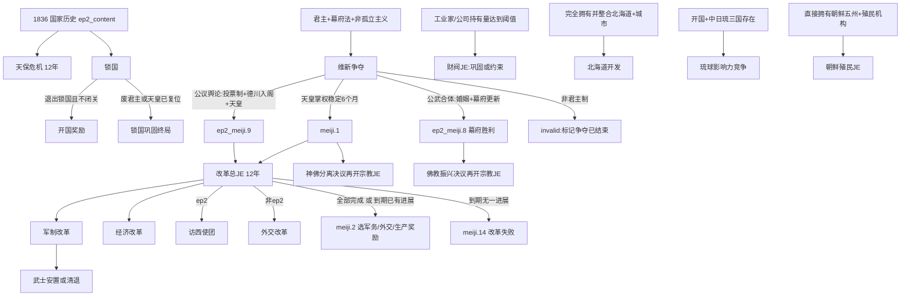

# 原版日本研究：1.13.11 / Steam build 24799966

研究日期：2026-11-02。范围：本机 GAME 原版脚本、历史初始化与资源数据库，只读；不启动游戏，不修改 GAME/MOD/技能。`catalog.py status` 返回 CURRENT、changed_count=0。本文件是原版研究，不是丰臣日本剧情方案，也不证明任一 MOD 分支已实现或实机可达。

方法：使用 NESND `scripts/pdx.py` 保序 AST，保留重复的 create_pop、create_building、option、role、modifier 等。附属 `native-inventory.json` 保存原始条目、源路径/行号、直接引用边与 SHA-256；所有表格中的人口、等级、资源、PM 都是初始化输入，绝不是游戏运行后的 GDP、实际就业、产量、价格、军费或财政。

## 1. 可用于设计的结论

1. 原版已有三种维新终局：天皇胜利、公武合体幕府胜利、公议舆论下保留德川政治地位。`fail` 在这条 JE 里是另一阵营获胜，不能直接译成玩家失败。共和国等非君主化走 `invalid` 并写结束标记。[je_meiji_restoration](<D:/Program Files (x86)/Steam/steamapps/common/Victoria 3/game/common/journal_entries/00_meiji_restoration.txt:1>)
2. 原版幕府不是换个政体名称：law_bakufu 退出会调用 `country_restore_japanese_emperor`，处理皇帝、前将军、继承人、摄政；家族链硬绑 Tokugawa/Yamato。丰臣世界线不能只替换本地化后照搬。[law_bakufu](<D:/Program Files (x86)/Steam/steamapps/common/Victoria 3/game/common/laws/00_distribution_of_power.txt:114>)；[country_restore_japanese_emperor](<D:/Program Files (x86)/Steam/steamapps/common/Victoria 3/game/common/scripted_effects/00_victoria_ep2_scripted_effects.txt:1>)
3. 不含九州的日本存在独立制度适配点：原版锁国法只许九州贸易，且可见性要求拥有九州最大 state。它影响开国路线、港口/贸易中心与对华贸易入口，而不是简单损失一州人口。[law_sakoku](<D:/Program Files (x86)/Steam/steamapps/common/Victoria 3/game/common/laws/01_trade_policy.txt:290>)
4. 分裂三政权需要检查国家变量与全局变量的区别。原版废大名使用 `japan_daimyo_abolished` 全局标记，武士终结使用 `fall_of_the_samurai_global_var`；三国共存时不能把一国的改制自然视为全日本共同完成。[country_clear_daimyo](<D:/Program Files (x86)/Steam/steamapps/common/Victoria 3/game/common/scripted_effects/00_victoria_ep2_scripted_effects.txt:2015>)；[meiji.3](<D:/Program Files (x86)/Steam/steamapps/common/Victoria 3/game/events/meiji_restoration.txt:345>)；[common/interest_groups/00_armed_forces.txt:132](<D:/Program Files (x86)/Steam/steamapps/common/Victoria 3/game/common/interest_groups/00_armed_forces.txt:132>)
5. 本轮找到的是日本维新、宗教、财阀、北海道、琉球、朝鲜链，以及通用自由主义/法西斯链；未找到一条命名为“大正民主”或“日本军国主义”的日本专属 JE 主线。军政人物与政治法律可以支撑新设计，但那属于之后的架空改编，不能声称原版已提供成套线路。日本原生 JE 全表见第2节。

## 2. 剧情入口、推进、终局

图中箭头是脚本因果/资格关系，不是承诺固定历史年份或必然发生。经济和军制子JE如果已满足条件，会直接记完成而跳过添加；使团由按钮和事件另行添加。真实添加位置：[events/meiji_restoration.txt:26](<D:/Program Files (x86)/Steam/steamapps/common/Victoria 3/game/events/meiji_restoration.txt:26>)、[events/meiji_restoration.txt:133](<D:/Program Files (x86)/Steam/steamapps/common/Victoria 3/game/events/meiji_restoration.txt:133>)、[events/japan_events/ep2_meiji_restoration.txt:938](<D:/Program Files (x86)/Steam/steamapps/common/Victoria 3/game/events/japan_events/ep2_meiji_restoration.txt:938>)。

| 原生JE | 入口/激活 | 完成、失败与退出 |
|---|---|---|
| [je_tenpo_crisis](<D:/Program Files (x86)/Steam/steamapps/common/Victoria 3/game/common/journal_entries/07_tenpo_crisis.txt:1>) | 国家历史在 ep2_content 下直接添加；首日 tenpo_events.1；本州5荒废+720日强度5暴雨 | 12年(4380日)内累计议程≥8→tenpo_events.3；逾期→.4；目标支持强硬/改革/混合奖励 |
| [je_sakoku](<D:/Program Files (x86)/Steam/steamapps/common/Victoria 3/game/common/journal_entries/07_sakoku.txt:1>) | 同一国家历史直接添加；按钮主动开国，年度事件含 ep2_sakoku.3 | 无锁国法且无闭关法→.4；废君主或天皇复位→.5；不是强制必须开国成功 |
| [je_meiji_restoration](<D:/Program Files (x86)/Steam/steamapps/common/Victoria 3/game/common/journal_entries/00_meiji_restoration.txt:1>) | 闲置可见JAP、君主、幕府、未结束；possible要求君主+幕府且非孤立主义/变体 | 帝方：天皇特质+无内战进度+无幕府法+地主领袖非德川连续6月；幕方两路线另见下文；非君主invalid |
| [je_meiji_imperial_marriage](<D:/Program Files (x86)/Steam/steamapps/common/Victoria 3/game/common/journal_entries/00_meiji_restoration.txt:496>) | 公武合体按钮→ep2_meiji.3→婚姻JE；保存统治者、公主和条约scope | 1825日内解除选中不利条约、闭关、非自由贸易、列岛无条约港→婚姻完成；失婚/逾期转公议舆论 |
| [je_meiji_main](<D:/Program Files (x86)/Steam/steamapps/common/Victoria 3/game/common/journal_entries/00_meiji_restoration.txt:640>) | meiji.1或ep2_meiji.9显式添加；没有开局possible自动铺开 | 12年；军制+经济+使团(ep2)/外交(无ep2)完成→meiji.2；到期有任一完成也给.2，否则.14 |
| [je_meiji_economy](<D:/Program Files (x86)/Steam/steamapps/common/Victoria 3/game/common/journal_entries/00_meiji_restoration.txt:744>) | 改革事件先检测是否已达目标，未达才添加 | 不违约；超过70%的整合州同时有≥5级城市中心及铁路；完成+1并设flag |
| [je_meiji_army](<D:/Program Files (x86)/Steam/steamapps/common/Victoria 3/game/common/journal_entries/00_meiji_restoration.txt:792>) | 改革事件按军制条件添加；实际JE完成条件比事件跳过检查更细，应分别读 | 非农奴/农民征召变体，军队IG不在政府，拿破仑战争，军营不含无组织/武士训练；含非正规单位的陆军编队比例不能≥25%；完成meiji.3 |
| [je_meiji_diplomacy](<D:/Program Files (x86)/Steam/steamapps/common/Victoria 3/game/common/journal_entries/00_meiji_restoration.txt:851>) | 仅无ep2改革支线 | 非传统主义、独立且recognized；完成+1并设flag |
| [je_iwakura_mission](<D:/Program Files (x86)/Steam/steamapps/common/Victoria 3/game/common/journal_entries/07_iwakura_mission.txt:1>) | 改革按钮→iwakura_mission.1选择团长→使团JE；法律和人物角色条件限制 | 返回且complete_iwakura_mission→.2；访问国/人物/学习量决定结果；不是固定历史团长 |
| [je_shinbutsu_bunri](<D:/Program Files (x86)/Steam/steamapps/common/Victoria 3/game/common/journal_entries/07_japanese_religion.txt:1>) | ep2且维新结束+天皇复位；决议要求教团不强大、信仰自由 | 10个指定日本owner-state各神道≥60%→japan_religion.11；完全分离/国家无神论等失败 |
| [je_elevate_buddhism](<D:/Program Files (x86)/Steam/steamapps/common/Victoria 3/game/common/journal_entries/07_japanese_religion.txt:155>) | ep2且维新结束但未天皇复位；教团不边缘、非完全分离/无神论；决议添加 | 原生目标完成且教团强大→japan_religion.12；教团边缘或世俗化失败 |
| [je_taming_the_north](<D:/Program Files (x86)/Steam/steamapps/common/Victoria 3/game/common/journal_entries/07_hokkaido.txt:1>) | ep2；JAP或特定EZO共和政体；有北海道；完全拥有+已整合+≥1城市 | 人口>50万、GDP>100万、农业潜力/耕地计数各≥3、建立殖民地标记→hokkaido_events.7；失去所有北海道→失败 |
| [je_ryukyu_rivalry](<D:/Program Files (x86)/Steam/steamapps/common/Victoria 3/game/common/journal_entries/01_ryukyu_rivalry.txt:1>) | ep2国际情势；日本已非孤立/闭关，RYU/CHI存在；参与者及scope另行控制 | 得分≥40日本胜，≤-40中国胜；第三方宗主、中日附庸、任一关键国家消失等invalid |
| [je_colonize_korea](<D:/Program Files (x86)/Steam/steamapps/common/Victoria 3/game/common/journal_entries/07_korea_colonization.txt:1>) | ep2、JAP、非孤立；殖民机构≥1，非无殖民；完整直接拥有朝鲜5州 | 机构≥3、行政充足、公司/投资条件、所有朝鲜state整合、动乱<25%、日本文化≥5%→.2；失控/独立KOR等→.3；废殖民机构invalid |
| [je_zaibatsu](<D:/Program Files (x86)/Steam/steamapps/common/Victoria 3/game/common/journal_entries/07_zaibatsu.txt:1>) | ep2、JAP、非孤立/传统/行会；工业家非边缘，>2公司槽，≥2四大财阀，≥100持有等级且≥10% | 巩固：已有财阀都繁荣、≥250级且≥25%；约束：合法性≥50、工业家离阁、选权或资本家政治力量条件、计划/合作制或份额<10%且无垄断；公司不足则invalid |

维新“幕府胜利”另要求合法性≥75、无内战进度，维新运动若存在须支持<5%或激进度<50%。公武合体要求仍有幕府法、`japan_renewed_bakufu`、`japan_completed_imperial_marriage`；公议舆论要求德川地主领袖在政府、有选举权、大和家统治者。国家结束变量在complete/fail/invalid三路都写入，避免同一争夺重复出现。[je_meiji_restoration](<D:/Program Files (x86)/Steam/steamapps/common/Victoria 3/game/common/journal_entries/00_meiji_restoration.txt:1>)

天保议程不是单一GDP条：强硬四项为秘密警察、严格江户制度、小市民边缘、≥40水稻；改革四项为3个日本家园州≥3城市、宽松江户制度、小市民势力≥10%、非世袭官僚；共通四项为陆军投射>500、海军要塞≥10、家园无饥荒、达到事件设定GDP目标；总计≥8。强硬/宽松和小市民强弱互斥，不能把它当十二项全做。[tenpo_total_agenda_goals_completed](<D:/Program Files (x86)/Steam/steamapps/common/Victoria 3/game/common/script_values/ep2_japan_values.txt:76>)

## 3. 从入口到底层的依赖闭包

| 链条层 | 已核来源与作用 |
|---|---|
| 国家开局 | [common/history/countries/jap - japan.txt:1](<D:/Program Files (x86)/Steam/steamapps/common/Victoria 3/game/common/history/countries/jap - japan.txt:1>) 启动科技、显式法律、警察机构1；ep2条件下添加天保/锁国；[common/history/characters/jap - japan.txt:1](<D:/Program Files (x86)/Steam/steamapps/common/Victoria 3/game/common/history/characters/jap - japan.txt:1>) 创建统治者、继承人、天皇与大名 |
| JE按钮 | [je_meiji_restoration_proclaim_imperial_restoration](<D:/Program Files (x86)/Steam/steamapps/common/Victoria 3/game/common/scripted_buttons/07_meiji_buttons.txt:1>)→ep2_meiji.5；[je_meiji_restoration_decide_shogunate_strategy](<D:/Program Files (x86)/Steam/steamapps/common/Victoria 3/game/common/scripted_buttons/07_meiji_buttons.txt:136>)→.2或切换路线变量；[je_meiji_restoration_imperial_marriage](<D:/Program Files (x86)/Steam/steamapps/common/Victoria 3/game/common/scripted_buttons/07_meiji_buttons.txt:253>)→.3 |
| 7日延迟分支 | [ep2_meiji.5](<D:/Program Files (x86)/Steam/steamapps/common/Victoria 3/game/events/japan_events/ep2_meiji_restoration.txt:492>)→.52(公武合体且合法性>50)或.51；[ep2_meiji.51](<D:/Program Files (x86)/Steam/steamapps/common/Victoria 3/game/events/japan_events/ep2_meiji_restoration.txt:555>)激活寡头法，按统治者/合法性再7日分.6或.7；[ep2_meiji.52](<D:/Program Files (x86)/Steam/steamapps/common/Victoria 3/game/events/japan_events/ep2_meiji_restoration.txt:672>)设置幕府更新标记 |
| 法律与统治者 | [law_bakufu](<D:/Program Files (x86)/Steam/steamapps/common/Victoria 3/game/common/laws/00_distribution_of_power.txt:114>)→[country_restore_japanese_emperor](<D:/Program Files (x86)/Steam/steamapps/common/Victoria 3/game/common/scripted_effects/00_victoria_ep2_scripted_effects.txt:1>) / [country_generate_japanese_shogun](<D:/Program Files (x86)/Steam/steamapps/common/Victoria 3/game/common/scripted_effects/00_victoria_ep2_scripted_effects.txt:177>)；退出幕府法不是仅换名称 |
| 大名与GUI | [je_meiji_restoration_update_japanese_emperor](<D:/Program Files (x86)/Steam/steamapps/common/Victoria 3/game/common/scripted_effects/00_sgui_effects.txt:2>)、[je_meiji_restoration_update_daimyos](<D:/Program Files (x86)/Steam/steamapps/common/Victoria 3/game/common/scripted_effects/00_sgui_effects.txt:79>)更新角色列表；[country_calculate_and_cache_daimyo_loyalties_per_state](<D:/Program Files (x86)/Steam/steamapps/common/Victoria 3/game/common/scripted_effects/00_victoria_ep2_scripted_effects.txt:1307>)缓存州忠诚；[gui/journal_entry_widgets/ep2_japan_widgets.gui:1](<D:/Program Files (x86)/Steam/steamapps/common/Victoria 3/game/gui/journal_entry_widgets/ep2_japan_widgets.gui:1>)呈现皇帝与大名列表 |
| 内战开始 | [common/on_actions/00_code_on_actions.txt:5502](<D:/Program Files (x86)/Steam/steamapps/common/Victoria 3/game/common/on_actions/00_code_on_actions.txt:5502>) country_has_pending_meiji_restoration→[meiji_civil_war_effects](<D:/Program Files (x86)/Steam/steamapps/common/Victoria 3/game/common/scripted_effects/00_victoria_ep2_scripted_effects.txt:2167>)按州归属转移大名、调整角色；其触发判断同时认active/inactive JE |
| 战争目标结算 | [common/on_actions/00_code_on_actions.txt:6672](<D:/Program Files (x86)/Steam/steamapps/common/Victoria 3/game/common/on_actions/00_code_on_actions.txt:6672>)→[japan_reconcile_revolutionary_daimyos](<D:/Program Files (x86)/Steam/steamapps/common/Victoria 3/game/common/scripted_effects/00_victoria_ep2_scripted_effects.txt:2505>)→补缺大名和刷新列表 |
| 继承与死亡 | [common/on_actions/00_code_on_actions.txt:2817](<D:/Program Files (x86)/Steam/steamapps/common/Victoria 3/game/common/on_actions/00_code_on_actions.txt:2817>)、[common/on_actions/00_code_on_actions.txt:3083](<D:/Program Files (x86)/Steam/steamapps/common/Victoria 3/game/common/on_actions/00_code_on_actions.txt:3083>)→[character_japan_imperial_succession_chain_effect](<D:/Program Files (x86)/Steam/steamapps/common/Victoria 3/game/common/scripted_effects/00_victoria_royal_successions.txt:946>) / [character_japan_ruler_succession_chain_effect](<D:/Program Files (x86)/Steam/steamapps/common/Victoria 3/game/common/scripted_effects/00_victoria_royal_successions.txt:866>)；[common/on_actions/00_code_on_actions.txt:3112](<D:/Program Files (x86)/Steam/steamapps/common/Victoria 3/game/common/on_actions/00_code_on_actions.txt:3112>)→[on_new_ruler_japan_effect](<D:/Program Files (x86)/Steam/steamapps/common/Victoria 3/game/common/scripted_effects/00_victoria_ep2_scripted_effects.txt:3083>) |
| 月/年脉冲 | [common/on_actions/00_code_on_actions.txt:1561](<D:/Program Files (x86)/Steam/steamapps/common/Victoria 3/game/common/on_actions/00_code_on_actions.txt:1561>)、[common/on_actions/00_code_on_actions.txt:1836](<D:/Program Files (x86)/Steam/steamapps/common/Victoria 3/game/common/on_actions/00_code_on_actions.txt:1836>)接入日本王室；[common/on_actions/00_on_actions_yearly.txt:595](<D:/Program Files (x86)/Steam/steamapps/common/Victoria 3/game/common/on_actions/00_on_actions_yearly.txt:595>)日本生活事件，:610地震；[common/on_actions/00_code_on_actions.txt:1581](<D:/Program Files (x86)/Steam/steamapps/common/Victoria 3/game/common/on_actions/00_code_on_actions.txt:1581>)日本IG改组事件 |
| 制度层 | [institution_police](<D:/Program Files (x86)/Steam/steamapps/common/Victoria 3/game/common/institutions/00_institutions.txt:31>)每级动乱效果-10%；原版开局明确1级。[institution_colonial_affairs](<D:/Program Files (x86)/Steam/steamapps/common/Victoria 3/game/common/institutions/00_institutions.txt:1>)与朝鲜殖民资格挂钩。[law_terakoya](<D:/Program Files (x86)/Steam/steamapps/common/Victoria 3/game/common/laws/01_education_system.txt:265>)直接教育可及性+25%、农民另+20%、科研-10%；它不在此块中显式设置学校机构等级 |
| 宗教后置解锁 | [shinbutsu_bunri_decision](<D:/Program Files (x86)/Steam/steamapps/common/Victoria 3/game/common/decisions/japan_shinto.txt:65>) / [elevate_buddhism_decision](<D:/Program Files (x86)/Steam/steamapps/common/Victoria 3/game/common/decisions/japan_shinto.txt:98>)→两宗教JE→japan_religion.11/.12；这是“主线已完+后续条件达成再生成JE”的完整原版实例 |
| 公司与政治 | [je_zaibatsu](<D:/Program Files (x86)/Steam/steamapps/common/Victoria 3/game/common/journal_entries/07_zaibatsu.txt:1>)→zaibatsu.1/.2→经济法修正案/IG/选举信心；[common/company_types/00_companies_japan.txt:1](<D:/Program Files (x86)/Steam/steamapps/common/Victoria 3/game/common/company_types/00_companies_japan.txt:1>)公司数据库；选举信心月漂移由[common/on_actions/00_code_on_actions.txt:1535](<D:/Program Files (x86)/Steam/steamapps/common/Victoria 3/game/common/on_actions/00_code_on_actions.txt:1535>)统一处理 |

以上已读到调用者、事件/按钮、脚本effect/trigger、法律/机构/角色数据库及JE界面引用。附属JSON保留完整重复节点和直接引用边；不声称对所有GUI动画/肖像贴图做视觉验收，也未解析引擎执行后的继承/内战结果。

## 4. 中国、朝鲜、民主与军政的原版素材边界

琉球的原版关系是日本的朝贡国，EZO是日本的vassal；不是日本完整直辖的两州。琉球竞争按钮分别使用宣示宗主权、当地港口投资≥2级、军事通行/造船投资与将军派驻、宗教尊崇等条件；中国也能操作，对手与琉球有延迟回应。可以借鉴“贸易/投资/军事顾问/宗教”四种外交资源，而不把它们改写成只有战争的单线。[common/history/diplomacy/00_subject_relationships.txt:644](<D:/Program Files (x86)/Steam/steamapps/common/Victoria 3/game/common/history/diplomacy/00_subject_relationships.txt:644>)；[je_ryukyu_rivalry_sway_merchants_button](<D:/Program Files (x86)/Steam/steamapps/common/Victoria 3/game/common/scripted_buttons/ryukyu_rivalry_buttons.txt:194>)；[je_ryukyu_rivalry_inspect_defenses_button](<D:/Program Files (x86)/Steam/steamapps/common/Victoria 3/game/common/scripted_buttons/ryukyu_rivalry_buttons.txt:302>)；[je_ryukyu_rivalry_honor_kikoeogimi_button](<D:/Program Files (x86)/Steam/steamapps/common/Victoria 3/game/common/scripted_buttons/ryukyu_rivalry_buttons.txt:421>)

朝鲜有两套不同主线：其一是ep1东学运动，依韩国主文化、地理、技术、外国集团影响力与激进人口开启，派生请愿/起义，国际JE保存韩国君主、宗主和日本scope；政府胜利且日本参与、朝鲜仍为原宗主附属时，7日后日本获gg_korea.8交涉。其二是日本ep2在已经完整占有朝鲜五州后的殖民治理JE，要求殖民机构、投资、整合、低动乱与移民比重；它不是侵略朝鲜的开战按钮。[je_donghak_movement](<D:/Program Files (x86)/Steam/steamapps/common/Victoria 3/game/common/journal_entries/03_korea.txt:1>)；[je_gyojo_shinwon](<D:/Program Files (x86)/Steam/steamapps/common/Victoria 3/game/common/journal_entries/03_korea.txt:97>)；[je_korean_rebellion](<D:/Program Files (x86)/Steam/steamapps/common/Victoria 3/game/common/journal_entries/03_korea.txt:189>)；[je_colonize_korea](<D:/Program Files (x86)/Steam/steamapps/common/Victoria 3/game/common/journal_entries/07_korea_colonization.txt:1>)

改革结算的军务奖励只在军制改革完成时可选，并添加朝鲜五州尚未持有部分的宣称；外交奖励需使团/外交改革，生产奖励需经济改革。它提供有条件的扩张倾向，未强迫对朝战争发生。[meiji.2](<D:/Program Files (x86)/Steam/steamapps/common/Victoria 3/game/events/meiji_restoration.txt:222>)

民主可用素材：原版兰学者在开放贸易和边境后改名知识分子、移除rangaku并获constitutionalism；财阀JE按有无选举权切换修正，约束财阀的民主选项给选举信心。通用`je_liberalism_1`先以democracy/international_trade技术显现，再要求政府中自由派/相应人物激活；完成需普选或财产普查选举、合法性≥50、和平且无叛乱IG，随后liberalism.1添加贸易/思想/移民支线。这是制度和政治力量共同驱动的入口模板。[japan_politics.1](<D:/Program Files (x86)/Steam/steamapps/common/Victoria 3/game/events/japan_events/ep2_japan_political_events.txt:4>)；[je_zaibatsu](<D:/Program Files (x86)/Steam/steamapps/common/Victoria 3/game/common/journal_entries/07_zaibatsu.txt:1>)；[je_liberalism_1](<D:/Program Files (x86)/Steam/steamapps/common/Victoria 3/game/common/journal_entries/00_liberalism.txt:2>)；[liberalism.1](<D:/Program Files (x86)/Steam/steamapps/common/Victoria 3/game/events/liberalism.txt:4>)

军政路线可用素材：山山县有authoritarian模板，陆军/军官政治力量受武士阶层法和幕府法影响，军制改革还可选择吸纳原武士或清退并制造军人激进派。通用法西斯JE需政治鼓动/大众宣传、社会主义威胁与≥10%激进人口，不能当作所有日本军事政府的同义词；其3年进度失败、胜利与后续警察/秘密警察/威权法巩固均有明确终局。[JAP_yamagata_aritomo](<D:/Program Files (x86)/Steam/steamapps/common/Victoria 3/game/common/character_templates/country_jap.txt:1902>)；[law_warrior_caste](<D:/Program Files (x86)/Steam/steamapps/common/Victoria 3/game/common/laws/00_army_model.txt:71>)；[meiji.3](<D:/Program Files (x86)/Steam/steamapps/common/Victoria 3/game/events/meiji_restoration.txt:345>)；[je_fascism_1](<D:/Program Files (x86)/Steam/steamapps/common/Victoria 3/game/common/journal_entries/00_fascism.txt:1>)；[je_fascism_2](<D:/Program Files (x86)/Steam/steamapps/common/Victoria 3/game/common/journal_entries/00_fascism.txt:281>)

## 5. 开局经济：实际历史输入

原版国家定义是unrecognized、empire tier、日本主文化、江户身份体系，首都京都。国家历史显式加入14项法律：君主、幕府、信仰自由、农奴制、世袭官僚、臣民制、锁国、地方警察、土地税、出版审查、中等江户制度、闭关、寺子屋、武士阶层（共14项activate_law，见原文；不把未在本文件显式写出的默认法混入已核清单）。税级medium，警察机构1。[JAP](<D:/Program Files (x86)/Steam/steamapps/common/Victoria 3/game/common/country_definitions/00_countries.txt:201>)；[common/history/countries/jap - japan.txt:1](<D:/Program Files (x86)/Steam/steamapps/common/Victoria 3/game/common/history/countries/jap - japan.txt:1>)

科技基线函数本名虽然含tier_4，实际授予的是围地、工场、炼钢、竖井、蒸馏、勘探，及早期军事/官僚/民主/国际贸易等一组技术；日本另加学术、城市规划、中央集权、执法、殖民、养蚕。不能按函数名把它解读为“已研发第四时代所有科技”。[effect_starting_technology_tier_4_tech](<D:/Program Files (x86)/Steam/steamapps/common/Victoria 3/game/common/scripted_effects/00_starting_inventions.txt:83>)；[common/history/countries/jap - japan.txt:3](<D:/Program Files (x86)/Steam/steamapps/common/Victoria 3/game/common/history/countries/jap - japan.txt:3>)

直接人口合计 **32,545,935**。以下资源数字为整个state_region数据库上限；北海道和琉球星号行只有部分province属于JAP，因此该行整州资源上限/耕地不能计作日本当下独占能力。九个完整州合计耕地805，煤66、铁100、铅200、硫121、林业106、渔业116。

| 原版州 | JAP人口输入 | JAP/全州province数 | 全州耕地 | 煤/铁/铅/硫上限 | JAP历史建筑等级合计 | 来源 |
|---|---:|---:|---:|---|---:|---|
| STATE_TOHOKU | 3,157,725 | 20/20 | 80 | 6/53/33/51 | 12 | [人口](<D:/Program Files (x86)/Steam/steamapps/common/Victoria 3/game/common/history/pops/11_east_asia.txt:1768>) / [资源](<D:/Program Files (x86)/Steam/steamapps/common/Victoria 3/game/map_data/state_regions/11_east_asia.txt:964>) / [归属](<D:/Program Files (x86)/Steam/steamapps/common/Victoria 3/game/common/history/states/00_states.txt:6967>) |
| STATE_HOKUSHINETSU | 4,138,700 | 9/9 | 104 | 0/15/4/6 | 13 | [人口](<D:/Program Files (x86)/Steam/steamapps/common/Victoria 3/game/common/history/pops/11_east_asia.txt:1777>) / [资源](<D:/Program Files (x86)/Steam/steamapps/common/Victoria 3/game/map_data/state_regions/11_east_asia.txt:1042>) / [归属](<D:/Program Files (x86)/Steam/steamapps/common/Victoria 3/game/common/history/states/00_states.txt:6998>) |
| STATE_KYOTO | 1,377,948 | 4/4 | 44 | 0/3/0/0 | 14 | [人口](<D:/Program Files (x86)/Steam/steamapps/common/Victoria 3/game/common/history/pops/11_east_asia.txt:1786>) / [资源](<D:/Program Files (x86)/Steam/steamapps/common/Victoria 3/game/map_data/state_regions/11_east_asia.txt:1091>) / [归属](<D:/Program Files (x86)/Steam/steamapps/common/Victoria 3/game/common/history/states/00_states.txt:7016>) |
| STATE_KANTO | 5,004,465 | 11/11 | 117 | 0/3/49/21 | 27 | [人口](<D:/Program Files (x86)/Steam/steamapps/common/Victoria 3/game/common/history/pops/11_east_asia.txt:1795>) / [资源](<D:/Program Files (x86)/Steam/steamapps/common/Victoria 3/game/map_data/state_regions/11_east_asia.txt:993>) / [归属](<D:/Program Files (x86)/Steam/steamapps/common/Victoria 3/game/common/history/states/00_states.txt:6976>) |
| STATE_TOKAI | 4,192,918 | 10/10 | 107 | 0/0/38/12 | 19 | [人口](<D:/Program Files (x86)/Steam/steamapps/common/Victoria 3/game/common/history/pops/11_east_asia.txt:1828>) / [资源](<D:/Program Files (x86)/Steam/steamapps/common/Victoria 3/game/map_data/state_regions/11_east_asia.txt:1017>) / [归属](<D:/Program Files (x86)/Steam/steamapps/common/Victoria 3/game/common/history/states/00_states.txt:6989>) |
| STATE_KANSAI | 3,986,882 | 6/6 | 95 | 0/0/18/0 | 20 | [人口](<D:/Program Files (x86)/Steam/steamapps/common/Victoria 3/game/common/history/pops/11_east_asia.txt:1837>) / [资源](<D:/Program Files (x86)/Steam/steamapps/common/Victoria 3/game/map_data/state_regions/11_east_asia.txt:1069>) / [归属](<D:/Program Files (x86)/Steam/steamapps/common/Victoria 3/game/common/history/states/00_states.txt:7007>) |
| STATE_KYUSHU | 4,141,707 | 12/12 | 101 | 52/6/9/31 | 16 | [人口](<D:/Program Files (x86)/Steam/steamapps/common/Victoria 3/game/common/history/pops/11_east_asia.txt:1846>) / [资源](<D:/Program Files (x86)/Steam/steamapps/common/Victoria 3/game/map_data/state_regions/11_east_asia.txt:1113>) / [归属](<D:/Program Files (x86)/Steam/steamapps/common/Victoria 3/game/common/history/states/00_states.txt:7025>) |
| STATE_CHUGOKU | 4,077,516 | 8/8 | 101 | 8/16/11/0 | 9 | [人口](<D:/Program Files (x86)/Steam/steamapps/common/Victoria 3/game/common/history/pops/11_east_asia.txt:1874>) / [资源](<D:/Program Files (x86)/Steam/steamapps/common/Victoria 3/game/map_data/state_regions/11_east_asia.txt:1158>) / [归属](<D:/Program Files (x86)/Steam/steamapps/common/Victoria 3/game/common/history/states/00_states.txt:7049>) |
| STATE_SHIKOKU | 2,319,419 | 5/5 | 56 | 0/4/38/0 | 8 | [人口](<D:/Program Files (x86)/Steam/steamapps/common/Victoria 3/game/common/history/pops/11_east_asia.txt:1883>) / [资源](<D:/Program Files (x86)/Steam/steamapps/common/Victoria 3/game/map_data/state_regions/11_east_asia.txt:1181>) / [归属](<D:/Program Files (x86)/Steam/steamapps/common/Victoria 3/game/common/history/states/00_states.txt:7058>) |
| STATE_HOKKAIDO* | 31,204 | 3/24 | 25 | 59/4/7/22 | 2 | [人口](<D:/Program Files (x86)/Steam/steamapps/common/Victoria 3/game/common/history/pops/11_east_asia.txt:1893>) / [资源](<D:/Program Files (x86)/Steam/steamapps/common/Victoria 3/game/map_data/state_regions/11_east_asia.txt:934>) / [归属](<D:/Program Files (x86)/Steam/steamapps/common/Victoria 3/game/common/history/states/00_states.txt:6947>) |
| STATE_RYUKYU_ISLANDS* | 117,451 | 1/3 | 15 | 4/0/0/6 | 1 | [人口](<D:/Program Files (x86)/Steam/steamapps/common/Victoria 3/game/common/history/pops/11_east_asia.txt:1939>) / [资源](<D:/Program Files (x86)/Steam/steamapps/common/Victoria 3/game/map_data/state_regions/11_east_asia.txt:1138>) / [归属](<D:/Program Files (x86)/Steam/steamapps/common/Victoria 3/game/common/history/states/00_states.txt:7035>) |

补充整州资源/土地细项（仍为state_region潜力，非JAP当前开发量）：

| 州 | 金/林/渔/鲸上限 | 可发现资源 | 耕作种类与州特性 |
|---|---|---|---|
| STATE_TOHOKU | 2 / 15 / 15 / 5 | type=building_oil_rig, undiscovered_amount=4 | building_rice_farm, building_livestock_ranch, building_cotton_plantation, building_silk_plantation, building_tobacco_plantation, building_vineyard；特性 无显式特性 |
| STATE_HOKUSHINETSU | 3 / 10 / 16 / 0 | type=building_oil_rig, undiscovered_amount=7 | building_rice_farm, building_livestock_ranch, building_cotton_plantation, building_silk_plantation, building_tobacco_plantation, building_vineyard；特性 无显式特性 |
| STATE_KYOTO | 0 / 9 / 10 / 0 | 未显式定义 | building_rice_farm, building_livestock_ranch, building_cotton_plantation, building_silk_plantation, building_tea_plantation, building_tobacco_plantation；特性 无显式特性 |
| STATE_KANTO | 0 / 9 / 10 / 2 | 未显式定义 | building_rice_farm, building_livestock_ranch, building_cotton_plantation, building_silk_plantation, building_tea_plantation, building_tobacco_plantation, building_dye_plantation；特性 state_trait_edo_bay, state_trait_kanto_plain |
| STATE_TOKAI | 0 / 16 / 16 / 0 | type=building_oil_rig, undiscovered_amount=1 | building_rice_farm, building_livestock_ranch, building_cotton_plantation, building_silk_plantation, building_tea_plantation, building_tobacco_plantation, building_vineyard；特性 无显式特性 |
| STATE_KANSAI | 1 / 9 / 10 / 6 | 未显式定义 | building_rice_farm, building_livestock_ranch, building_cotton_plantation, building_opium_plantation, building_silk_plantation, building_tea_plantation, building_vineyard, building_tobacco_plantation, building_dye_plantation；特性 state_trait_nara_basin, state_trait_seto_inland_sea |
| STATE_KYUSHU | 1 / 7 / 18 / 0 | 未显式定义 | building_rice_farm, building_livestock_ranch, building_cotton_plantation, building_silk_plantation, building_dye_plantation, building_tea_plantation, building_tobacco_plantation, building_sugar_plantation；特性 state_trait_chikuho_coalfield, state_trait_nagasaki_bay |
| STATE_CHUGOKU | 0 / 20 / 12 / 3 | 未显式定义 | building_rice_farm, building_livestock_ranch, building_cotton_plantation, building_silk_plantation, building_dye_plantation, building_tea_plantation, building_tobacco_plantation；特性 state_trait_seto_inland_sea |
| STATE_SHIKOKU | 0 / 11 / 9 / 0 | 未显式定义 | building_rice_farm, building_livestock_ranch, building_cotton_plantation, building_silk_plantation, building_dye_plantation, building_tea_plantation, building_tobacco_plantation；特性 state_trait_seto_inland_sea |
| STATE_HOKKAIDO | 0 / 9 / 15 / 8 | type=building_gold_field, depleted_type=building_gold_mine, undiscovered_amount=4 | building_wheat_farm, building_livestock_ranch；特性 state_trait_ishikari_coalfield, state_trait_ishikari_wetlands_1 |
| STATE_RYUKYU_ISLANDS | 0 / 0 / 5 / 0 | 未显式定义 | building_rice_farm, building_livestock_ranch, building_cotton_plantation, building_tea_plantation, building_tobacco_plantation, building_sugar_plantation；特性 state_trait_naha_cane_fields |

文化/宗教create_pop输入合计（未填写religion表示该条未显式指定，不擅自归为某信仰）：

| 文化 | 显式宗教 | 人口 |
|---|---|---:|
| japanese | 未显式指定 | 32,436,230 |
| ryukyuan | 未显式指定 | 102,553 |
| han | 未显式指定 | 2,009 |
| dutch | 未显式指定 | 20 |
| ainu | 未显式指定 | 102 |
| ryukyuan | confucian | 5,021 |

所有权来源计算方法：逐个create_building保留并累加add_ownership中的levels；不把每条记录当作1级。共141级，涵盖以下显式建筑；未计引擎根据人口/编队等建立的自给农场、城市中心、军营等自动内容。

| 建筑类型 | 历史等级 | 州分布 | 已激活PM（不同组合分别列） |
|---|---:|---|---|
| [building_government_administration](<D:/Program Files (x86)/Steam/steamapps/common/Victoria 3/game/common/history/buildings/11_east_asia.txt:2145>) | 21 | TOHOKU:1；HOKUSHINETSU:1；KYOTO:4；KANTO:6；TOKAI:2；KANSAI:3；KYUSHU:2；CHUGOKU:1；SHIKOKU:1 | pm_horizontal_drawer_cabinets, pm_hereditary_bureaucrats, pm_religious_bureaucrats |
| [building_glassworks](<D:/Program Files (x86)/Steam/steamapps/common/Victoria 3/game/common/history/buildings/11_east_asia.txt:2156>) | 4 | TOHOKU:1；HOKUSHINETSU:1；KYOTO:1；TOKAI:1 | pm_forest_glass, pm_ceramics, pm_manual_glassblowing |
| [building_paper_mill](<D:/Program Files (x86)/Steam/steamapps/common/Victoria 3/game/common/history/buildings/11_east_asia.txt:2169>) | 5 | TOHOKU:1；KANTO:1；CHUGOKU:2；SHIKOKU:1 | pm_pulp_pressing, pm_automation_disabled |
| [building_tobacco_plantation](<D:/Program Files (x86)/Steam/steamapps/common/Victoria 3/game/common/history/buildings/11_east_asia.txt:2182>) | 9 | TOHOKU:1；HOKUSHINETSU:2；KANTO:1；KANSAI:1；KYUSHU:2；CHUGOKU:1；SHIKOKU:1 | default_building_tobacco_plantation, pm_road_carts |
| [building_logging_camp](<D:/Program Files (x86)/Steam/steamapps/common/Victoria 3/game/common/history/buildings/11_east_asia.txt:2195>) | 14 | TOHOKU:2；HOKUSHINETSU:2；KYOTO:1；KANTO:3；TOKAI:3；KANSAI:2；SHIKOKU:1 | pm_hardwood, pm_saw_mills, pm_no_equipment, pm_road_carts pm_hardwood, pm_simple_forestry, pm_no_equipment, pm_road_carts pm_no_hardwood, pm_saw_mills, pm_no_equipment, pm_road_carts pm_no_hardwood, pm_simple_forestry, pm_no_equipment, pm_road_carts |
| [building_silk_plantation](<D:/Program Files (x86)/Steam/steamapps/common/Victoria 3/game/common/history/buildings/11_east_asia.txt:2208>) | 4 | TOHOKU:1；KYOTO:1；KANTO:2 | default_building_silk_plantation, pm_road_carts |
| [building_rice_farm](<D:/Program Files (x86)/Steam/steamapps/common/Victoria 3/game/common/history/buildings/11_east_asia.txt:2221>) | 20 | TOHOKU:3；HOKUSHINETSU:4；KYOTO:1；KANTO:3；TOKAI:2；KANSAI:2；KYUSHU:4；CHUGOKU:1 | pm_herring_meal_farming_building_rice_farm, pm_tools_disabled, pm_fig_orchards_building_rice_farm pm_simple_farming_building_rice_farm, pm_tools_disabled, pm_fig_orchards_building_rice_farm |
| [building_fishing_wharf](<D:/Program Files (x86)/Steam/steamapps/common/Victoria 3/game/common/history/buildings/11_east_asia.txt:2234>) | 10 | TOHOKU:2；HOKUSHINETSU:1；KANTO:2；KANSAI:1；KYUSHU:1；CHUGOKU:1；HOKKAIDO:2 | pm_simple_fishing, pm_unrefrigerated |
| [building_furniture_manufactory](<D:/Program Files (x86)/Steam/steamapps/common/Victoria 3/game/common/history/buildings/11_east_asia.txt:2275>) | 4 | HOKUSHINETSU:1；KYOTO:1；KANTO:1；KANSAI:1 | pm_handcrafted_furniture, pm_automation_disabled, pm_luxury_furniture |
| [building_gold_mine](<D:/Program Files (x86)/Steam/steamapps/common/Victoria 3/game/common/history/buildings/11_east_asia.txt:2288>) | 1 | HOKUSHINETSU:1 | pm_picks_and_shovels_building_gold_mine, pm_no_explosives, pm_no_steam_automation, pm_road_carts |
| [building_food_industry](<D:/Program Files (x86)/Steam/steamapps/common/Victoria 3/game/common/history/buildings/11_east_asia.txt:2583>) | 5 | KYOTO:1；KANTO:2；TOKAI:1；KANSAI:1 | pm_disabled_distillery, pm_disabled_canning, pm_bakery, pm_manual_dough_processing |
| [building_tea_plantation](<D:/Program Files (x86)/Steam/steamapps/common/Victoria 3/game/common/history/buildings/11_east_asia.txt:2596>) | 14 | KYOTO:2；KANTO:1；TOKAI:9；KYUSHU:2 | default_building_tea_plantation, pm_road_carts |
| [building_livestock_ranch](<D:/Program Files (x86)/Steam/steamapps/common/Victoria 3/game/common/history/buildings/11_east_asia.txt:2635>) | 2 | KYOTO:2 | pm_open_air_stockyards, pm_simple_ranch, pm_standard_fences, pm_unrefrigerated |
| [building_tooling_workshop](<D:/Program Files (x86)/Steam/steamapps/common/Victoria 3/game/common/history/buildings/11_east_asia.txt:2355>) | 1 | KANTO:1 | pm_crude_tools, pm_automation_disabled |
| [building_port](<D:/Program Files (x86)/Steam/steamapps/common/Victoria 3/game/common/history/buildings/11_east_asia.txt:2379>) | 4 | KANTO:1；KYUSHU:3 | pm_basic_port |
| [building_construction_sector](<D:/Program Files (x86)/Steam/steamapps/common/Victoria 3/game/common/history/buildings/11_east_asia.txt:2416>) | 2 | KANTO:1；KANSAI:1 | pm_wooden_buildings |
| [building_dye_plantation](<D:/Program Files (x86)/Steam/steamapps/common/Victoria 3/game/common/history/buildings/11_east_asia.txt:2479>) | 4 | KANTO:1；KANSAI:1；SHIKOKU:2 | default_building_dye_plantation, pm_road_carts |
| [building_lead_mine](<D:/Program Files (x86)/Steam/steamapps/common/Victoria 3/game/common/history/buildings/11_east_asia.txt:2531>) | 2 | KANTO:1；SHIKOKU:1 | pm_picks_and_shovels_building_lead_mine, pm_no_explosives, pm_no_steam_automation, pm_road_carts |
| [building_cotton_plantation](<D:/Program Files (x86)/Steam/steamapps/common/Victoria 3/game/common/history/buildings/11_east_asia.txt:2702>) | 6 | TOKAI:1；KANSAI:2；CHUGOKU:2；SHIKOKU:1 | default_building_cotton_plantation, pm_road_carts |
| [building_textile_mill](<D:/Program Files (x86)/Steam/steamapps/common/Victoria 3/game/common/history/buildings/11_east_asia.txt:2769>) | 4 | KANSAI:3；CHUGOKU:1 | pm_handsewn_clothes, pm_craftsman_sewing, pm_traditional_looms |
| [building_shipyard](<D:/Program Files (x86)/Steam/steamapps/common/Victoria 3/game/common/history/buildings/11_east_asia.txt:2819>) | 1 | KANSAI:1 | pm_basic_shipbuilding |
| [building_whaling_station](<D:/Program Files (x86)/Steam/steamapps/common/Victoria 3/game/common/history/buildings/11_east_asia.txt:2897>) | 1 | KANSAI:1 | pm_unrefrigerated, pm_wooden_whaling_ships |
| [building_trade_center](<D:/Program Files (x86)/Steam/steamapps/common/Victoria 3/game/common/history/buildings/11_east_asia.txt:3001>) | 2 | KYUSHU:2 | pm_trade_center_trade_quantity_normal |
| [building_sugar_plantation](<D:/Program Files (x86)/Steam/steamapps/common/Victoria 3/game/common/history/buildings/11_east_asia.txt:3024>) | 1 | RYUKYU_ISLANDS:1 | default_building_sugar_plantation, pm_road_carts |

九州对完整原版JAP的边际输入：4,141,707人口、3/4港口、全部2级贸易中心、52/66个九个完整州煤矿上限；抽去九州后，直接人口剩28,404,228、历史建筑125级、港口1、贸易中心0，九个完整州组中的其余八州煤14。这个算术只表达原版输入差，不是NESND领土和人口的替代方案，亦不预测财政崩溃。

初始显式工业很浅：没有历史创建煤矿、铁矿、钢厂、武器厂、军火厂、铁路、电厂；有1工具坊、4纺织、5食品、4玻璃、5纸、4家具、1造船。矿藏丰富不等于矿业已经就业或产出。上述“没有”限定本轮JAP历史create_building记录，不否定引擎的自动生成或后续建设。

PM量纲例子：木架建造每满劳动力等级+2建造、耗25布75木；粗制工具每满劳动力等级耗30木产30工具；手缝衣耗40布产45衣；鲱鱼肥水稻耗10鱼产45粮（并受日本地理区域解锁）。它们是workforce_scaled系数，叠加PM、就业、吞吐、地方价格等才决定真实结果；不在此计算假GDP或假盈亏。[pm_wooden_buildings](<D:/Program Files (x86)/Steam/steamapps/common/Victoria 3/game/common/production_methods/13_construction.txt:1>)；[pm_crude_tools](<D:/Program Files (x86)/Steam/steamapps/common/Victoria 3/game/common/production_methods/01_industry.txt:920>)；[pm_handsewn_clothes](<D:/Program Files (x86)/Steam/steamapps/common/Victoria 3/game/common/production_methods/01_industry.txt:274>)；[pm_herring_meal_farming_building_rice_farm](<D:/Program Files (x86)/Steam/steamapps/common/Victoria 3/game/common/production_methods/02_agro.txt:291>)

初始财富函数：基础11，上层+15、中层+7、劳工-2、农民-3；另调用奴隶重设。识字函数：基础0.35，官僚/学者/教士/工程师+0.5，上层+0.35，职员/店主+0.1，自给农业/牧业-0.1，未整合州再×0.5。原文件注释提及90%/75%/50%/30%，但实际代码分别为85%/70%/45%/25%基准，故报告以表达式为准；没有职业分配后的加权全国读数。[effect_starting_pop_wealth_medium](<D:/Program Files (x86)/Steam/steamapps/common/Victoria 3/game/common/scripted_effects/00_starting_pop_wealth.txt:82>)；[effect_starting_pop_literacy_middling](<D:/Program Files (x86)/Steam/steamapps/common/Victoria 3/game/common/scripted_effects/00_starting_pop_literacy.txt:121>)

| 陆军编队 | 单位创建输入 | 计数 | 来源 |
|---|---|---:|---|
| Edo_Guard_Army | KANTO 18 非正规步兵；TOKAI 4 非正规步兵；KANSAI 4 非正规步兵 | 26 | [common/history/military_formations/06_military_formations_asia.txt:548](<D:/Program Files (x86)/Steam/steamapps/common/Victoria 3/game/common/history/military_formations/06_military_formations_asia.txt:548>) |
| Kinai_Guard_Army | KANSAI 6 非正规步兵；KYOTO 4 非正规步兵；TOKAI 6 非正规步兵；CHUGOKU 2 非正规步兵；SHIKOKU 2 非正规步兵 | 20 | [common/history/military_formations/06_military_formations_asia.txt:570](<D:/Program Files (x86)/Steam/steamapps/common/Victoria 3/game/common/history/military_formations/06_military_formations_asia.txt:570>) |
| Kyushu_Guard_Army | KYUSHU 8 非正规步兵；CHUGOKU 4 非正规步兵 | 12 | [common/history/military_formations/06_military_formations_asia.txt:602](<D:/Program Files (x86)/Steam/steamapps/common/Victoria 3/game/common/history/military_formations/06_military_formations_asia.txt:602>) |

共58非正规步兵，三个陆军均驻东北亚战略区；本JAP历史块未创建海军。这里不把58自动称为满编兵员、战斗力或可持续军费。军事PM默认分配需要引擎状态，历史编队块只证明单位类型与州输入。

## 6. 人物：原版存在、生成条件与架空改编分开

原版country_jap.txt共112个模板，包含两皇室备用随机模板；不等于1836已生成人数。历史人物块直接创建20人，另ep2条件加会泽正志斋1人。开局将军德川家齐、继承人家庆、天皇仁孝；7个IG首领、江川英龙/鸟居耀藏两将领及8个浮动大名。完整历史创建位置：[common/history/characters/jap - japan.txt:1](<D:/Program Files (x86)/Steam/steamapps/common/Victoria 3/game/common/history/characters/jap - japan.txt:1>)。

下表列可供政治路线比较的模板。只说明原版游戏分配，不把该意识形态当作对真实历史人物的完整评判，更不据此宣布他们在丰臣世界线仍将出生、属于同一派别或按相同年份登场。表内“候选使用”是引擎模板池资格，非定时保证生成。

| 原版模板 | 出生日期输入 | IG/理念 | 候选使用或开局角色 |
|---|---|---|---|
| [JAP_ienari_tokugawa](<D:/Program Files (x86)/Steam/steamapps/common/Victoria 3/game/common/character_templates/country_jap.txt:193>) | 1773.11.18 | ig_landowners / ideology_traditionalist | ruler |
| [JAP_ieyoshi_tokugawa](<D:/Program Files (x86)/Steam/steamapps/common/Victoria 3/game/common/character_templates/country_jap.txt:219>) | 1793.6.22 | ig_landowners / ideology_traditionalist | heir |
| [JAP_ninko_yamato](<D:/Program Files (x86)/Steam/steamapps/common/Victoria 3/game/common/character_templates/country_jap.txt:28>) | 1800.1.1 | ig_devout / ideology_moderate | character_role_emperor_of_japan |
| [JAP_komei_yamato](<D:/Program Files (x86)/Steam/steamapps/common/Victoria 3/game/common/character_templates/country_jap.txt:52>) | 1831.1.1 | ig_armed_forces / ideology_shojoi | character_role_emperor_of_japan |
| [JAP_meiji_yamato](<D:/Program Files (x86)/Steam/steamapps/common/Victoria 3/game/common/character_templates/country_jap.txt:82>) | 1852.1.1 | ig_industrialists / ideology_modernizer_leader | character_role_emperor_of_japan |
| [JAP_taisho_yamato](<D:/Program Files (x86)/Steam/steamapps/common/Victoria 3/game/common/character_templates/country_jap.txt:112>) | 1879.1.1 | ig_industrialists / ideology_moderate | character_role_emperor_of_japan |
| [JAP_showa_yamato](<D:/Program Files (x86)/Steam/steamapps/common/Victoria 3/game/common/character_templates/country_jap.txt:147>) | 1901.1.1 | ig_armed_forces / ideology_moderate | character_role_emperor_of_japan |
| [JAP_yoshinobu_tokugawa](<D:/Program Files (x86)/Steam/steamapps/common/Victoria 3/game/common/character_templates/country_jap.txt:324>) | 1837.10.28 | ig_landowners / ideology_modernizer_leader | 显式创建/继承链 |
| [JAP_yamagata_aritomo](<D:/Program Files (x86)/Steam/steamapps/common/Victoria 3/game/common/character_templates/country_jap.txt:1902>) | 1838.6.14 | ig_armed_forces / ideology_authoritarian | interest_group_leader_usage: 1858.1.1–1922.1.1 |
| [JAP_ito_hirobumi](<D:/Program Files (x86)/Steam/steamapps/common/Victoria 3/game/common/character_templates/country_jap.txt:1929>) | 1841.10.16 | ig_armed_forces / ideology_authoritarian | interest_group_leader_usage: 1885.1.1–1909.1.1 |
| [JAP_fukuzawa_yukichi](<D:/Program Files (x86)/Steam/steamapps/common/Victoria 3/game/common/character_templates/country_jap.txt:1956>) | 1835.1.10 | ig_intelligentsia / ideology_modernizer_leader | interest_group_leader_usage: 1860.1.1–1901.1.1 |
| [JAP_hara_takashi](<D:/Program Files (x86)/Steam/steamapps/common/Victoria 3/game/common/character_templates/country_jap.txt:2038>) | 1856.3.15 | ig_intelligentsia / ideology_liberal_leader | interest_group_leader_usage: 1882.1.1–1921.1.1 |
| [JAP_saionji_kinmochi](<D:/Program Files (x86)/Steam/steamapps/common/Victoria 3/game/common/character_templates/country_jap.txt:2065>) | 1849.12.7 | ig_intelligentsia / ideology_liberal_leader | interest_group_leader_usage: 1903.1.1–1936.1.1 |
| [JAP_katsura_taro](<D:/Program Files (x86)/Steam/steamapps/common/Victoria 3/game/common/character_templates/country_jap.txt:2092>) | 1848.1.4 | ig_armed_forces / ideology_authoritarian | interest_group_leader_usage: 1898.1.1–1913.1.1 |
| [JAP_okuma_shigenobu](<D:/Program Files (x86)/Steam/steamapps/common/Victoria 3/game/common/character_templates/country_jap.txt:2120>) | 1838.1.10 | ig_petty_bourgeoisie / ideology_reformer | interest_group_leader_usage: 1868.1.1–1922.1.1 |
| [JAP_iwakura_tomomi](<D:/Program Files (x86)/Steam/steamapps/common/Victoria 3/game/common/character_templates/country_jap.txt:2291>) | 1825.10.26 | ig_petty_bourgeoisie / ideology_modernizer_leader | interest_group_leader_usage: 1854.1.1–1883.1.1 |
| [JAP_hamaguchi_osachi](<D:/Program Files (x86)/Steam/steamapps/common/Victoria 3/game/common/character_templates/country_jap.txt:2207>) | 1870.4.1 | ig_petty_bourgeoisie / ideology_liberal_leader | interest_group_leader_usage: 1895.1.1–1931.1.1 |
| [JAP_yukio_ozaki](<D:/Program Files (x86)/Steam/steamapps/common/Victoria 3/game/common/character_templates/country_jap.txt:2820>) | 1858.12.24 | ig_intelligentsia / ideology_liberal_leader | interest_group_leader_usage: 1890.1.1–1936.1.1 |
| [JAP_sakamoto_ryoma](<D:/Program Files (x86)/Steam/steamapps/common/Victoria 3/game/common/character_templates/country_jap.txt:2963>) | 1836.1.3 | ig_armed_forces / ideology_shojoi | agitator_usage: 1860.1.1–1895.1.1 |
| [JAP_nakae_chomin](<D:/Program Files (x86)/Steam/steamapps/common/Victoria 3/game/common/character_templates/country_jap.txt:2764>) | 1847.12.8 | ig_petty_bourgeoisie / ideology_radical | agitator_usage: 1874.1.1–1901.1.1 |
| [JAP_kotoku_denjiro](<D:/Program Files (x86)/Steam/steamapps/common/Victoria 3/game/common/character_templates/country_jap.txt:2792>) | 1871.11.5 | ig_trade_unions / ideology_anarchist | agitator_usage: 1890.1.1–1911.1.1 |
| [JAP_sakai_toshihiko](<D:/Program Files (x86)/Steam/steamapps/common/Victoria 3/game/common/character_templates/country_jap.txt:3078>) | 1871.1.15 | ig_trade_unions / ideology_communist | agitator_usage: 1900.1.1–1933.1.1 |
| [JAP_kishida_toshiko](<D:/Program Files (x86)/Steam/steamapps/common/Victoria 3/game/common/character_templates/country_jap.txt:2875>) | 1863.1.14 | ig_petty_bourgeoisie / ideology_feminist | agitator_usage: 1882.1.1–1901.1.1 |
| [JAP_hiratsuka_raicho](<D:/Program Files (x86)/Steam/steamapps/common/Victoria 3/game/common/character_templates/country_jap.txt:2904>) | 1886.2.10 | ig_intelligentsia / ideology_humanitarian | agitator_usage: 1911.1.1–1936.1.1 |
| [JAP_yosano_akiko](<D:/Program Files (x86)/Steam/steamapps/common/Victoria 3/game/common/character_templates/country_jap.txt:2933>) | 1878.12.7 | ig_petty_bourgeoisie / ideology_feminist | agitator_usage: 1901.1.1–1936.1.1 |
| [JAP_suzuki_bunji](<D:/Program Files (x86)/Steam/steamapps/common/Victoria 3/game/common/character_templates/country_jap.txt:2265>) | 1885.9.4 | ig_trade_unions / ideology_corporatist_leader | interest_group_leader_usage: 1912.1.1–1946.1.1 |
| [JAP_shibusawa_eiichi](<D:/Program Files (x86)/Steam/steamapps/common/Victoria 3/game/common/character_templates/country_jap.txt:1778>) | 1840.3.16 | ig_industrialists / ideology_modernizer_leader | executive_usage: 1845.1.1–1885.1.1 |

原版自然候选常见硬门槛是 `c:JAP ?= this` + `has_dlc_feature = ep2_content`，例如山县有朋1858–1922、原敬1882–1921、岸田俊子1882–1901（75概率）等。分裂后的非JAP tag不会自动共享这些候选；需要先决定人物存亡、家乡与教育网络，再在之后设计时处理，而非无条件复制112人。[JAP_yamagata_aritomo](<D:/Program Files (x86)/Steam/steamapps/common/Victoria 3/game/common/character_templates/country_jap.txt:1902>)；[JAP_hara_takashi](<D:/Program Files (x86)/Steam/steamapps/common/Victoria 3/game/common/character_templates/country_jap.txt:2038>)；[JAP_kishida_toshiko](<D:/Program Files (x86)/Steam/steamapps/common/Victoria 3/game/common/character_templates/country_jap.txt:2875>)

## 7. 可借鉴的“后续按国情出现”模板

| 形态 | 实际原版链 | 对后续设计的意义（推论） |
|---|---|---|
| 完成flag→决议资格→添加子JE | [je_meiji_restoration](<D:/Program Files (x86)/Steam/steamapps/common/Victoria 3/game/common/journal_entries/00_meiji_restoration.txt:1>)→[shinbutsu_bunri_decision](<D:/Program Files (x86)/Steam/steamapps/common/Victoria 3/game/common/decisions/japan_shinto.txt:65>)→[je_shinbutsu_bunri](<D:/Program Files (x86)/Steam/steamapps/common/Victoria 3/game/common/journal_entries/07_japanese_religion.txt:1>) | 主线不必常驻；保留国家完成标记，后续法律/IG条件达到后再解锁。 |
| 先检测是否已达目标 | [events/meiji_restoration.txt:133](<D:/Program Files (x86)/Steam/steamapps/common/Victoria 3/game/events/meiji_restoration.txt:133>)→满足就设completed变量，否则添加经济JE | 路线不同的国家可以跳过已经完成的改革，避免强制重复任务。 |
| 实际经济结构门槛 | [je_zaibatsu](<D:/Program Files (x86)/Steam/steamapps/common/Victoria 3/game/common/journal_entries/07_zaibatsu.txt:1>) | 公司数、持有份额、IG势力形成后才出现；统一与分裂国家不宜共用不经量纲调整的绝对100/250级阈值。 |
| 主权/领土/城市组合门槛 | [je_taming_the_north](<D:/Program Files (x86)/Steam/steamapps/common/Victoria 3/game/common/journal_entries/07_hokkaido.txt:1>) | 拥有部分州只显示前景，完全拥有、整合和城市化才进入开发。 |
| 外部地区治理门槛 | [je_colonize_korea](<D:/Program Files (x86)/Steam/steamapps/common/Victoria 3/game/common/journal_entries/07_korea_colonization.txt:1>) | 区分征服前外交与征服后治理；部分占领、附属朝鲜和完全直辖需要不同资格。 |
| 科技+执政力量门槛 | [je_liberalism_1](<D:/Program Files (x86)/Steam/steamapps/common/Victoria 3/game/common/journal_entries/00_liberalism.txt:2>) | 民主并非某年自动出现，而随技术与执政政治力量改变。 |

这几种均有当前原版实例，但并不代表NESND应该复制原版数字、德川/天皇合法性前提或所有DLC限制。只读研究可确证脚本形状；接入架空三国后的scope、国家消失、领土失去、旧档继承与玩家AI行为仍需后续实现闭包和定向验收。

## 8. 原版事件目录与直接调用索引

日本专属的15个JE与124个事件均已保序采样；另收录通用政治与朝鲜参考，总计27个JE、170个事件、535条直接引用边。以下按原文件列出日本事件ID；事件各自trigger/immediate/option/after完整内容与源行在JSON，不把事件池权重当作保证发生率。

| 文件 | 事件（ID:起始行） |
|---|---|
| [events/meiji_restoration.txt:1](<D:/Program Files (x86)/Steam/steamapps/common/Victoria 3/game/events/meiji_restoration.txt:1>) | meiji.1:4；meiji.2:222；meiji.3:345；meiji.4:427；meiji.5:553；meiji.6:696；meiji.7:817；meiji.8:966；meiji.9:1040；meiji.10:1117；meiji.11:1189；meiji.12:1306；meiji.13:1396；meiji.14:1457 |
| [events/japan_events/ep2_ezo_republic.txt:1](<D:/Program Files (x86)/Steam/steamapps/common/Victoria 3/game/events/japan_events/ep2_ezo_republic.txt:1>) | ezo_republic.1:3；ezo_republic.2:194 |
| [events/japan_events/ep2_hokkaido_events.txt:1](<D:/Program Files (x86)/Steam/steamapps/common/Victoria 3/game/events/japan_events/ep2_hokkaido_events.txt:1>) | hokkaido_events.1:4；hokkaido_events.2:242；hokkaido_events.3:446；hokkaido_events.4:632；hokkaido_events.5:818；hokkaido_events.6:968；hokkaido_events.7:1074；hokkaido_events.8:1199 |
| [events/japan_events/ep2_imperial_events.txt:1](<D:/Program Files (x86)/Steam/steamapps/common/Victoria 3/game/events/japan_events/ep2_imperial_events.txt:1>) | japan_monarchy.1:4；japan_monarchy.2:152；japan_monarchy.3:240；japan_monarchy.4:327；japan_monarchy.5:414；japan_monarchy.6:463 |
| [events/japan_events/ep2_iwakura_events.txt:1](<D:/Program Files (x86)/Steam/steamapps/common/Victoria 3/game/events/japan_events/ep2_iwakura_events.txt:1>) | iwakura_mission.1:4；iwakura_mission.2:189；iwakura_mission.4:418；iwakura_mission.5:489；iwakura_mission.6:561；iwakura_mission.7:678；iwakura_mission.8:799；iwakura_mission.9:901 |
| [events/japan_events/ep2_japan_earthquake_events.txt:1](<D:/Program Files (x86)/Steam/steamapps/common/Victoria 3/game/events/japan_events/ep2_japan_earthquake_events.txt:1>) | japan_earthquakes.1:7；japan_earthquakes.2:117；japan_earthquakes.3:195；japan_earthquakes.4:279；japan_earthquakes.5:364 |
| [events/japan_events/ep2_japan_events.txt:1](<D:/Program Files (x86)/Steam/steamapps/common/Victoria 3/game/events/japan_events/ep2_japan_events.txt:1>) | japan_events.1:4；japan_events.2:181；japan_events.3:331；japan_events.4:508；japan_events.5:708 |
| [events/japan_events/ep2_japan_events_03.txt:1](<D:/Program Files (x86)/Steam/steamapps/common/Victoria 3/game/events/japan_events/ep2_japan_events_03.txt:1>) | japan_events.31:6；japan_events.32:128；japan_events.33:239；japan_events.34:353；japan_events.35:443 |
| [events/japan_events/ep2_japan_political_events.txt:1](<D:/Program Files (x86)/Steam/steamapps/common/Victoria 3/game/events/japan_events/ep2_japan_political_events.txt:1>) | japan_politics.1:4；japan_politics.2:58；japan_politics.3:110 |
| [events/japan_events/ep2_korea_colonization.txt:1](<D:/Program Files (x86)/Steam/steamapps/common/Victoria 3/game/events/japan_events/ep2_korea_colonization.txt:1>) | korea_colonization.2:4；korea_colonization.3:124 |
| [events/japan_events/ep2_meiji_restoration.txt:1](<D:/Program Files (x86)/Steam/steamapps/common/Victoria 3/game/events/japan_events/ep2_meiji_restoration.txt:1>) | ep2_meiji.1:3；ep2_meiji.2:107；ep2_meiji.3:192；ep2_meiji.4:324；ep2_meiji.41:384；ep2_meiji.5:492；ep2_meiji.51:555；ep2_meiji.52:672；ep2_meiji.6:731；ep2_meiji.7:812；ep2_meiji.8:881；ep2_meiji.9:938；ep2_meiji.1000:1106；ep2_meiji_pulse.1:1164；ep2_meiji_pulse.11:1297；ep2_meiji_pulse.2:1347；ep2_meiji_pulse.3:1423；ep2_meiji_pulse.4:1598；ep2_meiji_pulse.5:1710；ep2_meiji_pulse.6:1834；ep2_meiji_pulse.7:1924；ep2_meiji_pulse.8:2046；ep2_meiji_pulse.9:2138 |
| [events/japan_events/ep2_sakoku_events.txt:1](<D:/Program Files (x86)/Steam/steamapps/common/Victoria 3/game/events/japan_events/ep2_sakoku_events.txt:1>) | ep2_sakoku.2:6；ep2_sakoku.3:157；ep2_sakoku.4:324；ep2_sakoku.5:370 |
| [events/japan_events/ep2_shogunate_events.txt:1](<D:/Program Files (x86)/Steam/steamapps/common/Victoria 3/game/events/japan_events/ep2_shogunate_events.txt:1>) | shogunate.1:4；shogunate.2:66；shogunate.3:223；shogunate.4:281；shogunate.5:336；shogunate.6:483；shogunate.7:646；shogunate.8:701 |
| [events/japan_events/ep2_tenpo_events.txt:1](<D:/Program Files (x86)/Steam/steamapps/common/Victoria 3/game/events/japan_events/ep2_tenpo_events.txt:1>) | tenpo_events.1:4；tenpo_events.2:73；tenpo_events.3:247；tenpo_events.4:370；tenpo_events.5:509；tenpo_events.6:701；tenpo_events.7:908；tenpo_events.8:1019 |
| [events/japan_events/ep2_zaibatsu_events.txt:1](<D:/Program Files (x86)/Steam/steamapps/common/Victoria 3/game/events/japan_events/ep2_zaibatsu_events.txt:1>) | zaibatsu.1:3；zaibatsu.2:106 |
| [events/japan_events/japan_religion_events.txt:1](<D:/Program Files (x86)/Steam/steamapps/common/Victoria 3/game/events/japan_events/japan_religion_events.txt:1>) | japan_religion.1:4；japan_religion.2:91；japan_religion.3:192；japan_religion.4:277；japan_religion.5:338；japan_religion.6:400；japan_religion.7:523；japan_religion.8:591；japan_religion.9:702；japan_religion.10:758；japan_religion.11:825；japan_religion.12:865；japan_religion.13:905 |
| [events/japan_events/ryukyu_rivalry_events.txt:1](<D:/Program Files (x86)/Steam/steamapps/common/Victoria 3/game/events/japan_events/ryukyu_rivalry_events.txt:1>) | ryukyu_rivalry.1:4；ryukyu_rivalry.2:159；ryukyu_rivalry.3:210；ryukyu_rivalry.4:270；ryukyu_rivalry.5:309；ryukyu_rivalry.6:523；ryukyu_rivalry.7:599；ryukyu_rivalry.8:707 |

主链的逐条直接调用（展示JE/按钮/添加子JE与核心转场；全量见JSON）：

| 调用者 | 边类型 | 目标 | 调用位置 |
|---|---|---|
| `je_meiji_restoration` | button | `je_meiji_restoration_proclaim_imperial_restoration` | [common/journal_entries/00_meiji_restoration.txt:6](<D:/Program Files (x86)/Steam/steamapps/common/Victoria 3/game/common/journal_entries/00_meiji_restoration.txt:6>) |
| `je_meiji_restoration` | button | `je_meiji_restoration_decide_shogunate_strategy` | [common/journal_entries/00_meiji_restoration.txt:7](<D:/Program Files (x86)/Steam/steamapps/common/Victoria 3/game/common/journal_entries/00_meiji_restoration.txt:7>) |
| `je_meiji_restoration` | button | `je_meiji_restoration_imperial_marriage` | [common/journal_entries/00_meiji_restoration.txt:8](<D:/Program Files (x86)/Steam/steamapps/common/Victoria 3/game/common/journal_entries/00_meiji_restoration.txt:8>) |
| `je_meiji_restoration` | event | `ep2_meiji.1` | [common/journal_entries/00_meiji_restoration.txt:47](<D:/Program Files (x86)/Steam/steamapps/common/Victoria 3/game/common/journal_entries/00_meiji_restoration.txt:47>) |
| `je_meiji_restoration` | event | `meiji.1` | [common/journal_entries/00_meiji_restoration.txt:157](<D:/Program Files (x86)/Steam/steamapps/common/Victoria 3/game/common/journal_entries/00_meiji_restoration.txt:157>) |
| `je_meiji_restoration` | event | `ep2_meiji.8` | [common/journal_entries/00_meiji_restoration.txt:342](<D:/Program Files (x86)/Steam/steamapps/common/Victoria 3/game/common/journal_entries/00_meiji_restoration.txt:342>) |
| `je_meiji_restoration` | event | `ep2_meiji.9` | [common/journal_entries/00_meiji_restoration.txt:350](<D:/Program Files (x86)/Steam/steamapps/common/Victoria 3/game/common/journal_entries/00_meiji_restoration.txt:350>) |
| `je_meiji_main` | button | `je_iwakura_mission_button` | [common/journal_entries/00_meiji_restoration.txt:645](<D:/Program Files (x86)/Steam/steamapps/common/Victoria 3/game/common/journal_entries/00_meiji_restoration.txt:645>) |
| `je_meiji_main` | button | `je_end_edo_system_button` | [common/journal_entries/00_meiji_restoration.txt:646](<D:/Program Files (x86)/Steam/steamapps/common/Victoria 3/game/common/journal_entries/00_meiji_restoration.txt:646>) |
| `je_meiji_main` | event | `meiji.2` | [common/journal_entries/00_meiji_restoration.txt:681](<D:/Program Files (x86)/Steam/steamapps/common/Victoria 3/game/common/journal_entries/00_meiji_restoration.txt:681>) |
| `je_meiji_main` | event | `meiji.2` | [common/journal_entries/00_meiji_restoration.txt:697](<D:/Program Files (x86)/Steam/steamapps/common/Victoria 3/game/common/journal_entries/00_meiji_restoration.txt:697>) |
| `je_meiji_main` | event | `meiji.14` | [common/journal_entries/00_meiji_restoration.txt:700](<D:/Program Files (x86)/Steam/steamapps/common/Victoria 3/game/common/journal_entries/00_meiji_restoration.txt:700>) |
| `je_meiji_main` | event | `meiji.14` | [common/journal_entries/00_meiji_restoration.txt:714](<D:/Program Files (x86)/Steam/steamapps/common/Victoria 3/game/common/journal_entries/00_meiji_restoration.txt:714>) |
| `je_meiji_army` | event | `meiji.3` | [common/journal_entries/00_meiji_restoration.txt:830](<D:/Program Files (x86)/Steam/steamapps/common/Victoria 3/game/common/journal_entries/00_meiji_restoration.txt:830>) |
| `je_ryukyu_rivalry` | progress_bar | `je_ryukyu_rivalry_score_bar` | [common/journal_entries/01_ryukyu_rivalry.txt:5](<D:/Program Files (x86)/Steam/steamapps/common/Victoria 3/game/common/journal_entries/01_ryukyu_rivalry.txt:5>) |
| `je_ryukyu_rivalry` | progress_bar | `je_ryukyu_rivalry_progress_bar` | [common/journal_entries/01_ryukyu_rivalry.txt:6](<D:/Program Files (x86)/Steam/steamapps/common/Victoria 3/game/common/journal_entries/01_ryukyu_rivalry.txt:6>) |
| `je_ryukyu_rivalry` | button | `je_ryukyu_rivalry_reaffirm_suzerainty_button` | [common/journal_entries/01_ryukyu_rivalry.txt:8](<D:/Program Files (x86)/Steam/steamapps/common/Victoria 3/game/common/journal_entries/01_ryukyu_rivalry.txt:8>) |
| `je_ryukyu_rivalry` | button | `je_ryukyu_rivalry_sway_merchants_button` | [common/journal_entries/01_ryukyu_rivalry.txt:9](<D:/Program Files (x86)/Steam/steamapps/common/Victoria 3/game/common/journal_entries/01_ryukyu_rivalry.txt:9>) |
| `je_ryukyu_rivalry` | button | `je_ryukyu_rivalry_inspect_defenses_button` | [common/journal_entries/01_ryukyu_rivalry.txt:10](<D:/Program Files (x86)/Steam/steamapps/common/Victoria 3/game/common/journal_entries/01_ryukyu_rivalry.txt:10>) |
| `je_ryukyu_rivalry` | button | `je_ryukyu_rivalry_honor_kikoeogimi_button` | [common/journal_entries/01_ryukyu_rivalry.txt:11](<D:/Program Files (x86)/Steam/steamapps/common/Victoria 3/game/common/journal_entries/01_ryukyu_rivalry.txt:11>) |
| `je_ryukyu_rivalry` | event | `ryukyu_rivalry.8` | [common/journal_entries/01_ryukyu_rivalry.txt:58](<D:/Program Files (x86)/Steam/steamapps/common/Victoria 3/game/common/journal_entries/01_ryukyu_rivalry.txt:58>) |
| `je_ryukyu_rivalry` | event | `ryukyu_rivalry.8` | [common/journal_entries/01_ryukyu_rivalry.txt:62](<D:/Program Files (x86)/Steam/steamapps/common/Victoria 3/game/common/journal_entries/01_ryukyu_rivalry.txt:62>) |
| `je_ryukyu_rivalry` | event | `ryukyu_rivalry.8` | [common/journal_entries/01_ryukyu_rivalry.txt:66](<D:/Program Files (x86)/Steam/steamapps/common/Victoria 3/game/common/journal_entries/01_ryukyu_rivalry.txt:66>) |
| `je_ryukyu_rivalry` | event | `ryukyu_rivalry.5` | [common/journal_entries/01_ryukyu_rivalry.txt:171](<D:/Program Files (x86)/Steam/steamapps/common/Victoria 3/game/common/journal_entries/01_ryukyu_rivalry.txt:171>) |
| `je_ryukyu_rivalry` | event | `ryukyu_rivalry.5` | [common/journal_entries/01_ryukyu_rivalry.txt:260](<D:/Program Files (x86)/Steam/steamapps/common/Victoria 3/game/common/journal_entries/01_ryukyu_rivalry.txt:260>) |
| `je_ryukyu_rivalry` | event | `ryukyu_rivalry.7` | [common/journal_entries/01_ryukyu_rivalry.txt:307](<D:/Program Files (x86)/Steam/steamapps/common/Victoria 3/game/common/journal_entries/01_ryukyu_rivalry.txt:307>) |
| `je_taming_the_north` | button | `button_je_taming_the_north_establish_colonies` | [common/journal_entries/07_hokkaido.txt:6](<D:/Program Files (x86)/Steam/steamapps/common/Victoria 3/game/common/journal_entries/07_hokkaido.txt:6>) |
| `je_taming_the_north` | button | `button_je_taming_the_north_integrate_ainu` | [common/journal_entries/07_hokkaido.txt:7](<D:/Program Files (x86)/Steam/steamapps/common/Victoria 3/game/common/journal_entries/07_hokkaido.txt:7>) |
| `je_taming_the_north` | button | `button_je_taming_the_north_sapporo_agricultural_college` | [common/journal_entries/07_hokkaido.txt:8](<D:/Program Files (x86)/Steam/steamapps/common/Victoria 3/game/common/journal_entries/07_hokkaido.txt:8>) |
| `je_taming_the_north` | button | `button_je_taming_the_north_agriculture_potentials` | [common/journal_entries/07_hokkaido.txt:9](<D:/Program Files (x86)/Steam/steamapps/common/Victoria 3/game/common/journal_entries/07_hokkaido.txt:9>) |
| `je_taming_the_north` | button | `button_je_taming_the_north_agriculture_arable_land` | [common/journal_entries/07_hokkaido.txt:10](<D:/Program Files (x86)/Steam/steamapps/common/Victoria 3/game/common/journal_entries/07_hokkaido.txt:10>) |
| `je_taming_the_north` | event | `hokkaido_events.1` | [common/journal_entries/07_hokkaido.txt:71](<D:/Program Files (x86)/Steam/steamapps/common/Victoria 3/game/common/journal_entries/07_hokkaido.txt:71>) |
| `je_taming_the_north` | event | `hokkaido_events.7` | [common/journal_entries/07_hokkaido.txt:145](<D:/Program Files (x86)/Steam/steamapps/common/Victoria 3/game/common/journal_entries/07_hokkaido.txt:145>) |
| `je_taming_the_north` | event | `hokkaido_events.8` | [common/journal_entries/07_hokkaido.txt:245](<D:/Program Files (x86)/Steam/steamapps/common/Victoria 3/game/common/journal_entries/07_hokkaido.txt:245>) |
| `je_iwakura_mission` | button | `je_iwakura_mission_recall_mission` | [common/journal_entries/07_iwakura_mission.txt:8](<D:/Program Files (x86)/Steam/steamapps/common/Victoria 3/game/common/journal_entries/07_iwakura_mission.txt:8>) |
| `je_iwakura_mission` | event | `iwakura_mission.4` | [common/journal_entries/07_iwakura_mission.txt:69](<D:/Program Files (x86)/Steam/steamapps/common/Victoria 3/game/common/journal_entries/07_iwakura_mission.txt:69>) |
| `je_iwakura_mission` | event | `iwakura_mission.2` | [common/journal_entries/07_iwakura_mission.txt:116](<D:/Program Files (x86)/Steam/steamapps/common/Victoria 3/game/common/journal_entries/07_iwakura_mission.txt:116>) |
| `je_shinbutsu_bunri` | button | `je_taikyo_proclamation_button` | [common/journal_entries/07_japanese_religion.txt:10](<D:/Program Files (x86)/Steam/steamapps/common/Victoria 3/game/common/journal_entries/07_japanese_religion.txt:10>) |
| `je_shinbutsu_bunri` | event | `japan_religion.11` | [common/journal_entries/07_japanese_religion.txt:114](<D:/Program Files (x86)/Steam/steamapps/common/Victoria 3/game/common/journal_entries/07_japanese_religion.txt:114>) |
| `je_elevate_buddhism` | event | `japan_religion.12` | [common/journal_entries/07_japanese_religion.txt:200](<D:/Program Files (x86)/Steam/steamapps/common/Victoria 3/game/common/journal_entries/07_japanese_religion.txt:200>) |
| `je_colonize_korea` | event | `korea_colonization.2` | [common/journal_entries/07_korea_colonization.txt:156](<D:/Program Files (x86)/Steam/steamapps/common/Victoria 3/game/common/journal_entries/07_korea_colonization.txt:156>) |
| `je_colonize_korea` | event | `korea_colonization.3` | [common/journal_entries/07_korea_colonization.txt:239](<D:/Program Files (x86)/Steam/steamapps/common/Victoria 3/game/common/journal_entries/07_korea_colonization.txt:239>) |
| `je_sakoku` | button | `je_sakoku_stop_being_closed_button` | [common/journal_entries/07_sakoku.txt:10](<D:/Program Files (x86)/Steam/steamapps/common/Victoria 3/game/common/journal_entries/07_sakoku.txt:10>) |
| `je_sakoku` | event | `ep2_sakoku.4` | [common/journal_entries/07_sakoku.txt:33](<D:/Program Files (x86)/Steam/steamapps/common/Victoria 3/game/common/journal_entries/07_sakoku.txt:33>) |
| `je_sakoku` | event | `ep2_sakoku.5` | [common/journal_entries/07_sakoku.txt:67](<D:/Program Files (x86)/Steam/steamapps/common/Victoria 3/game/common/journal_entries/07_sakoku.txt:67>) |
| `je_tenpo_crisis` | button | `button_je_tenpo_combat_rice_hoarding` | [common/journal_entries/07_tenpo_crisis.txt:14](<D:/Program Files (x86)/Steam/steamapps/common/Victoria 3/game/common/journal_entries/07_tenpo_crisis.txt:14>) |
| `je_tenpo_crisis` | button | `button_je_tenpo_frugal_ordinance` | [common/journal_entries/07_tenpo_crisis.txt:15](<D:/Program Files (x86)/Steam/steamapps/common/Victoria 3/game/common/journal_entries/07_tenpo_crisis.txt:15>) |
| `je_tenpo_crisis` | button | `button_je_tenpo_confiscate_land` | [common/journal_entries/07_tenpo_crisis.txt:16](<D:/Program Files (x86)/Steam/steamapps/common/Victoria 3/game/common/journal_entries/07_tenpo_crisis.txt:16>) |
| `je_tenpo_crisis` | event | `tenpo_events.3` | [common/journal_entries/07_tenpo_crisis.txt:38](<D:/Program Files (x86)/Steam/steamapps/common/Victoria 3/game/common/journal_entries/07_tenpo_crisis.txt:38>) |
| `je_tenpo_crisis` | event | `tenpo_events.4` | [common/journal_entries/07_tenpo_crisis.txt:94](<D:/Program Files (x86)/Steam/steamapps/common/Victoria 3/game/common/journal_entries/07_tenpo_crisis.txt:94>) |
| `je_zaibatsu` | event | `zaibatsu.1` | [common/journal_entries/07_zaibatsu.txt:175](<D:/Program Files (x86)/Steam/steamapps/common/Victoria 3/game/common/journal_entries/07_zaibatsu.txt:175>) |
| `je_zaibatsu` | event | `zaibatsu.2` | [common/journal_entries/07_zaibatsu.txt:285](<D:/Program Files (x86)/Steam/steamapps/common/Victoria 3/game/common/journal_entries/07_zaibatsu.txt:285>) |
| `meiji.1` | add_je | `je_meiji_main` | [events/meiji_restoration.txt:43](<D:/Program Files (x86)/Steam/steamapps/common/Victoria 3/game/events/meiji_restoration.txt:43>) |
| `meiji.1` | add_je | `je_meiji_economy` | [events/meiji_restoration.txt:156](<D:/Program Files (x86)/Steam/steamapps/common/Victoria 3/game/events/meiji_restoration.txt:156>) |
| `meiji.1` | event | `meiji.3` | [events/meiji_restoration.txt:183](<D:/Program Files (x86)/Steam/steamapps/common/Victoria 3/game/events/meiji_restoration.txt:183>) |
| `meiji.1` | add_je | `je_meiji_army` | [events/meiji_restoration.txt:188](<D:/Program Files (x86)/Steam/steamapps/common/Victoria 3/game/events/meiji_restoration.txt:188>) |
| `meiji.1` | add_je | `je_meiji_diplomacy` | [events/meiji_restoration.txt:214](<D:/Program Files (x86)/Steam/steamapps/common/Victoria 3/game/events/meiji_restoration.txt:214>) |
| `ep2_meiji.5` | event | `ep2_meiji.52` | [events/japan_events/ep2_meiji_restoration.txt:539](<D:/Program Files (x86)/Steam/steamapps/common/Victoria 3/game/events/japan_events/ep2_meiji_restoration.txt:539>) |
| `ep2_meiji.5` | event | `ep2_meiji.51` | [events/japan_events/ep2_meiji_restoration.txt:546](<D:/Program Files (x86)/Steam/steamapps/common/Victoria 3/game/events/japan_events/ep2_meiji_restoration.txt:546>) |
| `ep2_meiji.51` | event | `ep2_meiji.6` | [events/japan_events/ep2_meiji_restoration.txt:640](<D:/Program Files (x86)/Steam/steamapps/common/Victoria 3/game/events/japan_events/ep2_meiji_restoration.txt:640>) |
| `ep2_meiji.51` | event | `ep2_meiji.7` | [events/japan_events/ep2_meiji_restoration.txt:656](<D:/Program Files (x86)/Steam/steamapps/common/Victoria 3/game/events/japan_events/ep2_meiji_restoration.txt:656>) |
| `ep2_meiji.9` | add_je | `je_meiji_main` | [events/japan_events/ep2_meiji_restoration.txt:973](<D:/Program Files (x86)/Steam/steamapps/common/Victoria 3/game/events/japan_events/ep2_meiji_restoration.txt:973>) |
| `ep2_meiji.9` | add_je | `je_meiji_economy` | [events/japan_events/ep2_meiji_restoration.txt:1041](<D:/Program Files (x86)/Steam/steamapps/common/Victoria 3/game/events/japan_events/ep2_meiji_restoration.txt:1041>) |
| `ep2_meiji.9` | event | `meiji.3` | [events/japan_events/ep2_meiji_restoration.txt:1068](<D:/Program Files (x86)/Steam/steamapps/common/Victoria 3/game/events/japan_events/ep2_meiji_restoration.txt:1068>) |
| `ep2_meiji.9` | add_je | `je_meiji_army` | [events/japan_events/ep2_meiji_restoration.txt:1073](<D:/Program Files (x86)/Steam/steamapps/common/Victoria 3/game/events/japan_events/ep2_meiji_restoration.txt:1073>) |
| `ep2_meiji.9` | add_je | `je_meiji_diplomacy` | [events/japan_events/ep2_meiji_restoration.txt:1099](<D:/Program Files (x86)/Steam/steamapps/common/Victoria 3/game/events/japan_events/ep2_meiji_restoration.txt:1099>) |
| `je_iwakura_mission_button` | event | `iwakura_mission.1` | [common/scripted_buttons/meiji_reform_buttons.txt:35](<D:/Program Files (x86)/Steam/steamapps/common/Victoria 3/game/common/scripted_buttons/meiji_reform_buttons.txt:35>) |
| `shinbutsu_bunri_decision` | add_je | `je_shinbutsu_bunri` | [common/decisions/japan_shinto.txt:81](<D:/Program Files (x86)/Steam/steamapps/common/Victoria 3/game/common/decisions/japan_shinto.txt:81>) |
| `elevate_buddhism_decision` | add_je | `je_elevate_buddhism` | [common/decisions/japan_shinto.txt:115](<D:/Program Files (x86)/Steam/steamapps/common/Victoria 3/game/common/decisions/japan_shinto.txt:115>) |

## 9. 来源指纹与边界

GAME根目录：`D:/Program Files (x86)/Steam/steamapps/common/Victoria 3/game`。以下SHA-256来自本轮实际读取文件字节；不是下载文档摘要。原始目录只读。main报告与附属JSON写在WORK。本轮没有引擎运行、没有静态检查充当游戏验收、没有数值方案修改。未完整展开的范围：所有非日本全球制度的传递依赖、全部肖像资源渲染、UI实际点击、所有DLC组合实测、GDP/财政/市场与战争模拟。

| 来源 | SHA-256 |
|---|---|
| [common/character_roles/00_auto_assigned_roles.txt:1](<D:/Program Files (x86)/Steam/steamapps/common/Victoria 3/game/common/character_roles/00_auto_assigned_roles.txt:1>) | `7c53b49f0f79ac683811b3d5f5085197915f18de00864df8dc3873935ce49763` |
| [common/character_roles/01_appointment_roles.txt:1](<D:/Program Files (x86)/Steam/steamapps/common/Victoria 3/game/common/character_roles/01_appointment_roles.txt:1>) | `8c0020876526679aa181e99854ed9d3f90ba7757f0f04079d9ae8be0270931ef` |
| [common/character_roles/02_unique_roles.txt:1](<D:/Program Files (x86)/Steam/steamapps/common/Victoria 3/game/common/character_roles/02_unique_roles.txt:1>) | `1246bb06157f7e0be054c0b25b5420a3dd82c7ec7343db99596a3affa5201e85` |
| [common/character_templates/country_jap.txt:1](<D:/Program Files (x86)/Steam/steamapps/common/Victoria 3/game/common/character_templates/country_jap.txt:1>) | `a727ba61139ffd2ed58419cced1ab0c8d52147cafc6f1eb4f6347922c249c864` |
| [common/character_traits/condition_traits.txt:1](<D:/Program Files (x86)/Steam/steamapps/common/Victoria 3/game/common/character_traits/condition_traits.txt:1>) | `d691744cecc2ba1a98a9dc3955cfee2b5d69b3bc7235dc1e46e35592bddb3c9f` |
| [common/character_traits/personality_traits.txt:1](<D:/Program Files (x86)/Steam/steamapps/common/Victoria 3/game/common/character_traits/personality_traits.txt:1>) | `d88995fcbe6bf3c482566f57ee93e214a4078ced19c7ba5817647803a0997c80` |
| [common/character_traits/skill_traits.txt:1](<D:/Program Files (x86)/Steam/steamapps/common/Victoria 3/game/common/character_traits/skill_traits.txt:1>) | `029ff0a10b52ddcef3c5a1b488ced6ee58e194abf273cae281a49d5d9acc4d2c` |
| [common/character_traits/special_personality_traits.txt:1](<D:/Program Files (x86)/Steam/steamapps/common/Victoria 3/game/common/character_traits/special_personality_traits.txt:1>) | `fcae9da6e94d97d63f531e00df152c4d07040d2b45d8380a5a2b845e209bff06` |
| [common/company_types/00_companies_japan.txt:1](<D:/Program Files (x86)/Steam/steamapps/common/Victoria 3/game/common/company_types/00_companies_japan.txt:1>) | `f626e624c2ae3ec808d8e550b108b85a7f3af51659f57ed9a316cce96b02904e` |
| [common/country_definitions/00_countries.txt:1](<D:/Program Files (x86)/Steam/steamapps/common/Victoria 3/game/common/country_definitions/00_countries.txt:1>) | `d13a2a5ddfe9391287be287041c28611599fed537d1d41c3fb5691de08872a74` |
| [common/decisions/japan_decisions.txt:1](<D:/Program Files (x86)/Steam/steamapps/common/Victoria 3/game/common/decisions/japan_decisions.txt:1>) | `74f0552b2c103c2b5e0934e244350ea7dd636718758fb36777122eae35cef838` |
| [common/decisions/japan_shinto.txt:1](<D:/Program Files (x86)/Steam/steamapps/common/Victoria 3/game/common/decisions/japan_shinto.txt:1>) | `75b66aed1659c2638cae71e3323ff192f97bfcb8118b9f6d133415b12ba3f2e9` |
| [common/history/buildings/11_east_asia.txt:1](<D:/Program Files (x86)/Steam/steamapps/common/Victoria 3/game/common/history/buildings/11_east_asia.txt:1>) | `84fd6a3f62730ebfd6a02bdf799c93337a8708b9fb37324c2fb23fbbfbb7cde4` |
| [common/history/characters/jap - japan.txt:1](<D:/Program Files (x86)/Steam/steamapps/common/Victoria 3/game/common/history/characters/jap - japan.txt:1>) | `7deb3b88f13c30af1e31dbb7d2936c94f1732bfba6713f0b0928c77dd5a01398` |
| [common/history/countries/jap - japan.txt:1](<D:/Program Files (x86)/Steam/steamapps/common/Victoria 3/game/common/history/countries/jap - japan.txt:1>) | `b9e7df278cb01ab2e5059a142d28a8102f88efcc0bae517c646787cc554113c5` |
| [common/history/diplomacy/00_relations.txt:1](<D:/Program Files (x86)/Steam/steamapps/common/Victoria 3/game/common/history/diplomacy/00_relations.txt:1>) | `99387942cdadc3b16454c01db9cc23f59681d0e579f7fd5bad1f4cc6039ab66f` |
| [common/history/diplomacy/00_subject_relationships.txt:1](<D:/Program Files (x86)/Steam/steamapps/common/Victoria 3/game/common/history/diplomacy/00_subject_relationships.txt:1>) | `62ebb4e8c528183521e0ae400a61ef14171d301a2e2dbf9893ed6efdfaca45ce` |
| [common/history/military_formations/06_military_formations_asia.txt:1](<D:/Program Files (x86)/Steam/steamapps/common/Victoria 3/game/common/history/military_formations/06_military_formations_asia.txt:1>) | `cc9865135448a224cd4b9ed1e56ab40e2aad6dc487881e33ad547b20c7a0d5e2` |
| [common/history/pops/11_east_asia.txt:1](<D:/Program Files (x86)/Steam/steamapps/common/Victoria 3/game/common/history/pops/11_east_asia.txt:1>) | `5aa5e4db00e5fa9f3e3e00d22b5212e7c26ec832459026b8a9314784afc2ff73` |
| [common/history/population/jap - japan.txt:1](<D:/Program Files (x86)/Steam/steamapps/common/Victoria 3/game/common/history/population/jap - japan.txt:1>) | `a781dad0ffa7c80c97f9294b261b4e56bdbb91ccd524dc83cf6eb38fef3c4aa3` |
| [common/history/states/00_states.txt:1](<D:/Program Files (x86)/Steam/steamapps/common/Victoria 3/game/common/history/states/00_states.txt:1>) | `d8408feff70da84e50d5cbf3fcc552841cb2bf8c0338bf997ce127f10423c50e` |
| [common/ideologies/00_ig_ideologies.txt:1](<D:/Program Files (x86)/Steam/steamapps/common/Victoria 3/game/common/ideologies/00_ig_ideologies.txt:1>) | `4c8bc020d2d1060795e5a615b850736b731a31193862399363ec2e1829639b05` |
| [common/ideologies/00_ig_ideologies_event.txt:1](<D:/Program Files (x86)/Steam/steamapps/common/Victoria 3/game/common/ideologies/00_ig_ideologies_event.txt:1>) | `9821d1dceb526c700eeb2a6351355bf2745004c747744bb8c855e1b1cd6e9f36` |
| [common/ideologies/00_ig_ideologies_flavored.txt:1](<D:/Program Files (x86)/Steam/steamapps/common/Victoria 3/game/common/ideologies/00_ig_ideologies_flavored.txt:1>) | `68b24613022a7d879337bd2a0c190c7c140b4c0ae2bd6db67770aaecdca87610` |
| [common/ideologies/01_character_ideologies.txt:1](<D:/Program Files (x86)/Steam/steamapps/common/Victoria 3/game/common/ideologies/01_character_ideologies.txt:1>) | `b54d0c294632be73ebc77edcb65d7f841803c6a19bacbb03e6331b0cd2ce39d3` |
| [common/ideologies/03_ig_ideologies_movement.txt:1](<D:/Program Files (x86)/Steam/steamapps/common/Victoria 3/game/common/ideologies/03_ig_ideologies_movement.txt:1>) | `063a0a979aac9c4f3d721da16866ce242e7b786c8b0ae7de1f54b9c8a05b4a92` |
| [common/institutions/00_institutions.txt:1](<D:/Program Files (x86)/Steam/steamapps/common/Victoria 3/game/common/institutions/00_institutions.txt:1>) | `9d3b8474e2e99a34cd23cc38343253b850d0b2991a0f9418c85577c68c8ece2b` |
| [common/interest_groups/00_armed_forces.txt:1](<D:/Program Files (x86)/Steam/steamapps/common/Victoria 3/game/common/interest_groups/00_armed_forces.txt:1>) | `a9bf6cdad3a02a13a0e3edacb9c23cf87cb8695065b6a97a859ba0a730f3ce47` |
| [common/interest_groups/00_intelligentsia.txt:1](<D:/Program Files (x86)/Steam/steamapps/common/Victoria 3/game/common/interest_groups/00_intelligentsia.txt:1>) | `8f724562643aca00d9d4718a93c6bf10399f02299d5e5ed7e5604d01e8d08788` |
| [common/interest_groups/00_landowners.txt:1](<D:/Program Files (x86)/Steam/steamapps/common/Victoria 3/game/common/interest_groups/00_landowners.txt:1>) | `833743373d938366f87c098e5773da7e5f232933b7a3f9fddee68e3f4da0b4d3` |
| [common/journal_entries/00_fascism.txt:1](<D:/Program Files (x86)/Steam/steamapps/common/Victoria 3/game/common/journal_entries/00_fascism.txt:1>) | `da01c819e6610e2b1278199c0987b8c050ac927a881482993af27ae20046315e` |
| [common/journal_entries/00_liberalism.txt:1](<D:/Program Files (x86)/Steam/steamapps/common/Victoria 3/game/common/journal_entries/00_liberalism.txt:1>) | `b158653cad59b6d761351a3db56b6be193a3347859f3eafced248e2e9b79c4f5` |
| [common/journal_entries/00_meiji_restoration.txt:1](<D:/Program Files (x86)/Steam/steamapps/common/Victoria 3/game/common/journal_entries/00_meiji_restoration.txt:1>) | `aaaf94eb3c4acd16e2985381ef68f6cd1cf1ca8fa012002ad2305c24faa135d0` |
| [common/journal_entries/01_coup.txt:1](<D:/Program Files (x86)/Steam/steamapps/common/Victoria 3/game/common/journal_entries/01_coup.txt:1>) | `f39d26651a3200b1044a2e79d070a8bfeebb205183079a9bb993ef6d520c5665` |
| [common/journal_entries/01_ryukyu_rivalry.txt:1](<D:/Program Files (x86)/Steam/steamapps/common/Victoria 3/game/common/journal_entries/01_ryukyu_rivalry.txt:1>) | `acb43f7f590803e0bfd868b89b9af931be0a44da4ee8d8e35a29b68b8ce0c743` |
| [common/journal_entries/03_korea.txt:1](<D:/Program Files (x86)/Steam/steamapps/common/Victoria 3/game/common/journal_entries/03_korea.txt:1>) | `a2effe143777fb9fc0b034dfbc92943f318aeecb4e62bdf459e101293b4d4093` |
| [common/journal_entries/07_hokkaido.txt:1](<D:/Program Files (x86)/Steam/steamapps/common/Victoria 3/game/common/journal_entries/07_hokkaido.txt:1>) | `867af26f75e9e3b4f90c603ddbf0e7b357eb57fb6b92ac0f7989b7756436724d` |
| [common/journal_entries/07_iwakura_mission.txt:1](<D:/Program Files (x86)/Steam/steamapps/common/Victoria 3/game/common/journal_entries/07_iwakura_mission.txt:1>) | `15bad277059552d795fcc66843af4fc2d28b1baa33a789cf751ac778a2d93f4f` |
| [common/journal_entries/07_japanese_religion.txt:1](<D:/Program Files (x86)/Steam/steamapps/common/Victoria 3/game/common/journal_entries/07_japanese_religion.txt:1>) | `7e4b96f4ea5134a1983de2fde8b16c60f3127fc40caf5acd038ea9a2c1a90234` |
| [common/journal_entries/07_korea_colonization.txt:1](<D:/Program Files (x86)/Steam/steamapps/common/Victoria 3/game/common/journal_entries/07_korea_colonization.txt:1>) | `48f246262ac93d7d722608d8e31e3a81bd75d423c4b2c340e575142e287a3eb8` |
| [common/journal_entries/07_sakoku.txt:1](<D:/Program Files (x86)/Steam/steamapps/common/Victoria 3/game/common/journal_entries/07_sakoku.txt:1>) | `142e4e23eec9d7667900a07a36016434dd53828492ad7ee829a84c7205b1f95e` |
| [common/journal_entries/07_tenpo_crisis.txt:1](<D:/Program Files (x86)/Steam/steamapps/common/Victoria 3/game/common/journal_entries/07_tenpo_crisis.txt:1>) | `37e7bf5859dd585d512cfe0b39e7383765598b7e8b69d4d4bd48afbb76c90ac2` |
| [common/journal_entries/07_zaibatsu.txt:1](<D:/Program Files (x86)/Steam/steamapps/common/Victoria 3/game/common/journal_entries/07_zaibatsu.txt:1>) | `cbcade9b9f356123356bc720d4bd2ade815cceae21076fdb01d705f630e1f94d` |
| [common/laws/00_army_model.txt:1](<D:/Program Files (x86)/Steam/steamapps/common/Victoria 3/game/common/laws/00_army_model.txt:1>) | `86c32fb873dd2c192728088b572466d73ef8e0f9cd78130e1e0121803dea17e3` |
| [common/laws/00_caste_hegemony.txt:1](<D:/Program Files (x86)/Steam/steamapps/common/Victoria 3/game/common/laws/00_caste_hegemony.txt:1>) | `0c31a075766c3fc3db997e23b9aa61d737fe0c4c1086a5c8f501a2d03eecbae8` |
| [common/laws/00_citizenship.txt:1](<D:/Program Files (x86)/Steam/steamapps/common/Victoria 3/game/common/laws/00_citizenship.txt:1>) | `c006054323511c81b40502810c4ed8f6a806ebde02bf0a3023538e756ec9bb10` |
| [common/laws/00_distribution_of_power.txt:1](<D:/Program Files (x86)/Steam/steamapps/common/Victoria 3/game/common/laws/00_distribution_of_power.txt:1>) | `014b5fcb89d4e4abb86c98c013364117a183daf569c9cb8d4ab0bb5ff833cd04` |
| [common/laws/01_education_system.txt:1](<D:/Program Files (x86)/Steam/steamapps/common/Victoria 3/game/common/laws/01_education_system.txt:1>) | `94508a8b3fe6612b2510aa99466304839e8d69114179deb16031e34cfff16275` |
| [common/laws/01_trade_policy.txt:1](<D:/Program Files (x86)/Steam/steamapps/common/Victoria 3/game/common/laws/01_trade_policy.txt:1>) | `f6e0ca1e180c57f994aae1a04ea3e407bfadd4ede85f75f67c303ed16d734e6d` |
| [common/on_actions/00_code_on_actions.txt:1](<D:/Program Files (x86)/Steam/steamapps/common/Victoria 3/game/common/on_actions/00_code_on_actions.txt:1>) | `ec3e3e97140777b10d4d99f41c528ec1dc6f1499429e3e2f566b3819a36e63bb` |
| [common/on_actions/00_on_actions_monthly.txt:1](<D:/Program Files (x86)/Steam/steamapps/common/Victoria 3/game/common/on_actions/00_on_actions_monthly.txt:1>) | `afc9a539b7b0b11634ad2ea36055dae61b6f8f8415b14cf8c1cb3f9e23d9df23` |
| [common/on_actions/00_on_actions_yearly.txt:1](<D:/Program Files (x86)/Steam/steamapps/common/Victoria 3/game/common/on_actions/00_on_actions_yearly.txt:1>) | `f520f18901e7136794d72e9647311ea5abb430e45ded311316138e1228c5ef1b` |
| [common/political_movements/00_ideological_movements.txt:1](<D:/Program Files (x86)/Steam/steamapps/common/Victoria 3/game/common/political_movements/00_ideological_movements.txt:1>) | `834a1b97f09c65b9b64eafdaffe4ee68965aaac262066140793a482eefd23a6b` |
| [common/political_movements/02_cultural_movement.txt:1](<D:/Program Files (x86)/Steam/steamapps/common/Victoria 3/game/common/political_movements/02_cultural_movement.txt:1>) | `6472b750bc0b8b564c1749ea3540faad98d27d10eed195fb0bb8396ff002607a` |
| [common/political_movements/04_country_specific_ideological_movements.txt:1](<D:/Program Files (x86)/Steam/steamapps/common/Victoria 3/game/common/political_movements/04_country_specific_ideological_movements.txt:1>) | `503590cec446a8016e09f65b491e7d529af97fadd76ee98c32d85d7c9baaafc6` |
| [common/production_methods/01_industry.txt:1](<D:/Program Files (x86)/Steam/steamapps/common/Victoria 3/game/common/production_methods/01_industry.txt:1>) | `d0abb71f6ba922f46e1e512810053d1206a3cbfd8a2ff419d8a66c87b8a36886` |
| [common/production_methods/02_agro.txt:1](<D:/Program Files (x86)/Steam/steamapps/common/Victoria 3/game/common/production_methods/02_agro.txt:1>) | `40d5d3d776783624e004321a66dc45848f1d8c3d3cb264c612e3521ae11829e5` |
| [common/production_methods/03_mines.txt:1](<D:/Program Files (x86)/Steam/steamapps/common/Victoria 3/game/common/production_methods/03_mines.txt:1>) | `5e182a3d1e885e0d99848a03070e952d6cd20e33cb2f2e4b5ffa9a2ba23d8931` |
| [common/production_methods/04_plantations.txt:1](<D:/Program Files (x86)/Steam/steamapps/common/Victoria 3/game/common/production_methods/04_plantations.txt:1>) | `7cd7cbbd269b358421b267405b4e2cc72548d40d3bec749b3d4ae9cc910bbc70` |
| [common/production_methods/05_military.txt:1](<D:/Program Files (x86)/Steam/steamapps/common/Victoria 3/game/common/production_methods/05_military.txt:1>) | `7ff5cd54ae6ba592a44b49231547fce54d93f6060663891394a88fe315c5b3b1` |
| [common/production_methods/07_government.txt:1](<D:/Program Files (x86)/Steam/steamapps/common/Victoria 3/game/common/production_methods/07_government.txt:1>) | `f74d57845a75e7568c211646366c1e809aa7242aebc712f42af4a728fb07d80d` |
| [common/production_methods/09_misc_resource.txt:1](<D:/Program Files (x86)/Steam/steamapps/common/Victoria 3/game/common/production_methods/09_misc_resource.txt:1>) | `e2aadd13e1b7042fc0ce85fb66ba016db0b3a06248e7a9d1eb5efa228d2bde0d` |
| [common/production_methods/11_private_infrastructure.txt:1](<D:/Program Files (x86)/Steam/steamapps/common/Victoria 3/game/common/production_methods/11_private_infrastructure.txt:1>) | `cd32009af5d592d99cf1a9822a57542b9e0b9ad82c7193f24ec32cf3799a017e` |
| [common/production_methods/13_construction.txt:1](<D:/Program Files (x86)/Steam/steamapps/common/Victoria 3/game/common/production_methods/13_construction.txt:1>) | `65d032301d83cf3ad200901af721454d786b77e29be3069e6ad862668d99dd85` |
| [common/script_values/ep2_japan_values.txt:1](<D:/Program Files (x86)/Steam/steamapps/common/Victoria 3/game/common/script_values/ep2_japan_values.txt:1>) | `fbe8069966e67a2b73a9bb7672a219092b19cea0aba3c857813deade510cca9e` |
| [common/script_values/event_values.txt:1](<D:/Program Files (x86)/Steam/steamapps/common/Victoria 3/game/common/script_values/event_values.txt:1>) | `2bde5cecb435cf0e41ed83987e7acd72adb41578ebc39df5970f176a39469581` |
| [common/scripted_buttons/07_iwakura_buttons.txt:1](<D:/Program Files (x86)/Steam/steamapps/common/Victoria 3/game/common/scripted_buttons/07_iwakura_buttons.txt:1>) | `846f632fb380f181bb61eb6fc6fb8f1cd783b08525b53f1a7712d57a6e4f7ad5` |
| [common/scripted_buttons/07_japan_buttons.txt:1](<D:/Program Files (x86)/Steam/steamapps/common/Victoria 3/game/common/scripted_buttons/07_japan_buttons.txt:1>) | `a123213b0096ff8907b5b779c755a142efa358725c12c47590900716bf13d4aa` |
| [common/scripted_buttons/07_japan_religion_buttons.txt:1](<D:/Program Files (x86)/Steam/steamapps/common/Victoria 3/game/common/scripted_buttons/07_japan_religion_buttons.txt:1>) | `dbcd52aede036f2e0d195ffd5dbfaa7bc82a5e5851d56bbc429e636078002c15` |
| [common/scripted_buttons/07_meiji_buttons.txt:1](<D:/Program Files (x86)/Steam/steamapps/common/Victoria 3/game/common/scripted_buttons/07_meiji_buttons.txt:1>) | `e0b644da5a745fd489fab290b8078c1db509f46a778f9b10bd6a67518deb9241` |
| [common/scripted_buttons/meiji_reform_buttons.txt:1](<D:/Program Files (x86)/Steam/steamapps/common/Victoria 3/game/common/scripted_buttons/meiji_reform_buttons.txt:1>) | `5840edfb841544bde2ec6cf24d8fccd53462ba534bae65dd526d956b339f4918` |
| [common/scripted_buttons/ryukyu_rivalry_buttons.txt:1](<D:/Program Files (x86)/Steam/steamapps/common/Victoria 3/game/common/scripted_buttons/ryukyu_rivalry_buttons.txt:1>) | `910808169623ce17a835aadbbe1326ba70ff29fda02695ed816c261994300aa5` |
| [common/scripted_effects/00_sgui_effects.txt:1](<D:/Program Files (x86)/Steam/steamapps/common/Victoria 3/game/common/scripted_effects/00_sgui_effects.txt:1>) | `06708f4bd732c30310e9188acf687fd50b1e264f48a76378730655f3877d1a8b` |
| [common/scripted_effects/00_starting_inventions.txt:1](<D:/Program Files (x86)/Steam/steamapps/common/Victoria 3/game/common/scripted_effects/00_starting_inventions.txt:1>) | `ed3f518ede32a343e986b71f892be17b6145d1f3010fe5f523a2507705a5de84` |
| [common/scripted_effects/00_starting_pop_literacy.txt:1](<D:/Program Files (x86)/Steam/steamapps/common/Victoria 3/game/common/scripted_effects/00_starting_pop_literacy.txt:1>) | `bd7a643cdde74863e05ec7565b9a35da4b14115b3afee2facdc42c11aad50598` |
| [common/scripted_effects/00_starting_pop_wealth.txt:1](<D:/Program Files (x86)/Steam/steamapps/common/Victoria 3/game/common/scripted_effects/00_starting_pop_wealth.txt:1>) | `c3dc09f61925a1d8746601396f388d5e0327031d9ca1256b66792015ae37ce27` |
| [common/scripted_effects/00_victoria_ep2_scripted_effects.txt:1](<D:/Program Files (x86)/Steam/steamapps/common/Victoria 3/game/common/scripted_effects/00_victoria_ep2_scripted_effects.txt:1>) | `5eb6dca67e7647b4d09dbeb1c22e0ab2b68cee66c04a7476375c581f074191dc` |
| [common/scripted_effects/00_victoria_heir_generation.txt:1](<D:/Program Files (x86)/Steam/steamapps/common/Victoria 3/game/common/scripted_effects/00_victoria_heir_generation.txt:1>) | `c7d00a1b4d382f9a4ac9c6ea99d9699a5fad7e9c2c2e2e886ea2286dc46ded68` |
| [common/scripted_effects/00_victoria_royal_successions.txt:1](<D:/Program Files (x86)/Steam/steamapps/common/Victoria 3/game/common/scripted_effects/00_victoria_royal_successions.txt:1>) | `30d871d640f8a82d18c23a1e82849b409c38a6f030386cf1e9dd7769acdeb26c` |
| [common/scripted_progress_bars/00_ep2_ryukyu_rivalry_progress_bars.txt:1](<D:/Program Files (x86)/Steam/steamapps/common/Victoria 3/game/common/scripted_progress_bars/00_ep2_ryukyu_rivalry_progress_bars.txt:1>) | `1252cbb7eb15be91704ccdb99298ceb615927abfee6fb9ae3e2f893ac029d6cf` |
| [common/scripted_progress_bars/00_ip4_victoria_progress_bars.txt:1](<D:/Program Files (x86)/Steam/steamapps/common/Victoria 3/game/common/scripted_progress_bars/00_ip4_victoria_progress_bars.txt:1>) | `da2c2aca01848a91b000739cd7a9e07b751e1ef8a5b31913c4abebf979f29dd1` |
| [common/scripted_progress_bars/00_victoria_progress_bars.txt:1](<D:/Program Files (x86)/Steam/steamapps/common/Victoria 3/game/common/scripted_progress_bars/00_victoria_progress_bars.txt:1>) | `979e4c2ab0077cc3de69b0242f648d1956dbd41899d0b0760e28bf67abd0e547` |
| [common/scripted_triggers/00_ep2_victoria_scripted_triggers.txt:1](<D:/Program Files (x86)/Steam/steamapps/common/Victoria 3/game/common/scripted_triggers/00_ep2_victoria_scripted_triggers.txt:1>) | `4170ec272e2e4930d36534f9268a5e110e3223a8e94655f4c5a07dcb40e211c3` |
| [common/static_modifiers/00_code_static_modifiers.txt:1](<D:/Program Files (x86)/Steam/steamapps/common/Victoria 3/game/common/static_modifiers/00_code_static_modifiers.txt:1>) | `0f42a271058ca8932c8b87641328473f1bc6a7961b7f4bf40663d5aba43faf1d` |
| [common/static_modifiers/00_ep2_01_modifiers.txt:1](<D:/Program Files (x86)/Steam/steamapps/common/Victoria 3/game/common/static_modifiers/00_ep2_01_modifiers.txt:1>) | `864fcbfae82485028df00d66607e9998aeb7590e10c732c81a78f1eae602fe18` |
| [common/static_modifiers/00_ep2_02_modifiers.txt:1](<D:/Program Files (x86)/Steam/steamapps/common/Victoria 3/game/common/static_modifiers/00_ep2_02_modifiers.txt:1>) | `151e77e1d57c7bd5b239674f7d5b13dfe4189f8d9b1dc0a7c4fba5067f37be47` |
| [common/static_modifiers/00_ep2_03_modifiers.txt:1](<D:/Program Files (x86)/Steam/steamapps/common/Victoria 3/game/common/static_modifiers/00_ep2_03_modifiers.txt:1>) | `8abcf91e57a10e1f2f376f9f3242af0b136f1dbdefa6d69a1582da3a2a055b42` |
| [common/static_modifiers/00_ep2_04_modifiers.txt:1](<D:/Program Files (x86)/Steam/steamapps/common/Victoria 3/game/common/static_modifiers/00_ep2_04_modifiers.txt:1>) | `eff2f10a343af908083a2ee5a3786a0468a6ef4f91919dc528cd1706023132f6` |
| [common/static_modifiers/00_ep2_05_modifiers.txt:1](<D:/Program Files (x86)/Steam/steamapps/common/Victoria 3/game/common/static_modifiers/00_ep2_05_modifiers.txt:1>) | `fc50983a9285fa89c917db8dc5b5579fd15721db9d87248f62cab4f6eab9c323` |
| [common/static_modifiers/00_ep2_06_modifiers.txt:1](<D:/Program Files (x86)/Steam/steamapps/common/Victoria 3/game/common/static_modifiers/00_ep2_06_modifiers.txt:1>) | `8b6b30e1bd6a5af6fd33affe9ce4480230fb5d2f5d3a509f54532f4fe05aa48f` |
| [common/static_modifiers/00_ip4_04_modifiers.txt:1](<D:/Program Files (x86)/Steam/steamapps/common/Victoria 3/game/common/static_modifiers/00_ip4_04_modifiers.txt:1>) | `a514e1fa61aa2178182506c90eb138f4bea53ad341fc20f9dbc1b6dbc5a7bf5c` |
| [common/static_modifiers/00_negotiation_modifiers.txt:1](<D:/Program Files (x86)/Steam/steamapps/common/Victoria 3/game/common/static_modifiers/00_negotiation_modifiers.txt:1>) | `fd9bc42d6fa9278c0049fd8fc0a2ff06cb1709a700d29fb63cc3261544fe3c00` |
| [common/static_modifiers/07_sphere_of_influence_4_modifiers.txt:1](<D:/Program Files (x86)/Steam/steamapps/common/Victoria 3/game/common/static_modifiers/07_sphere_of_influence_4_modifiers.txt:1>) | `35e4cb43ec1356ba6285430e2ebec08b1d50ce909f9190e68ab7a70b9ffdafb3` |
| [common/static_modifiers/104_modifiers.txt:1](<D:/Program Files (x86)/Steam/steamapps/common/Victoria 3/game/common/static_modifiers/104_modifiers.txt:1>) | `01ec03fb2a35d10b1e74fb3439af027933aea2f960e8adc1121d62241c30af42` |
| [common/static_modifiers/105_modifiers.txt:1](<D:/Program Files (x86)/Steam/steamapps/common/Victoria 3/game/common/static_modifiers/105_modifiers.txt:1>) | `4a0f8d1041eafd13f58f30e123d84f60789d4a8f38ebc16339482a7c5c3643d0` |
| [common/static_modifiers/agitators_3_modifiers.txt:1](<D:/Program Files (x86)/Steam/steamapps/common/Victoria 3/game/common/static_modifiers/agitators_3_modifiers.txt:1>) | `648f91e3d86d46c4646a79b55e86b79633bc84dc27b782ce5c3d1c4ff0762d84` |
| [common/static_modifiers/agitators_4_modifiers.txt:1](<D:/Program Files (x86)/Steam/steamapps/common/Victoria 3/game/common/static_modifiers/agitators_4_modifiers.txt:1>) | `3e7d471ea428712e08095d733ae73b1d821804fbbeea06a9bd82ccb1a65876a2` |
| [common/static_modifiers/agitators_5_modifiers.txt:1](<D:/Program Files (x86)/Steam/steamapps/common/Victoria 3/game/common/static_modifiers/agitators_5_modifiers.txt:1>) | `118c439c6fd26bea041de27e10014da78c07592c9c0a49cb953a8dd17250af0f` |
| [common/static_modifiers/content_1_modifiers.txt:1](<D:/Program Files (x86)/Steam/steamapps/common/Victoria 3/game/common/static_modifiers/content_1_modifiers.txt:1>) | `52cb2cb977445444bfb55833ffc73d91c30a9d5f4c318f50f512e660468b2dce` |
| [common/static_modifiers/content_304_modifiers.txt:1](<D:/Program Files (x86)/Steam/steamapps/common/Victoria 3/game/common/static_modifiers/content_304_modifiers.txt:1>) | `65b39f1a5051189ee09e6f3d5d9acf7ebf71a8b46d61ca401e7794053c3b1ddf` |
| [common/static_modifiers/japan_single_fire_events_modifiers.txt:1](<D:/Program Files (x86)/Steam/steamapps/common/Victoria 3/game/common/static_modifiers/japan_single_fire_events_modifiers.txt:1>) | `5b36d0f2c790fb3dccc09d9e4d768e11270c1accfe8b121ec5f97fa72f080bc0` |
| [events/agitators_events/coup_events.txt:1](<D:/Program Files (x86)/Steam/steamapps/common/Victoria 3/game/events/agitators_events/coup_events.txt:1>) | `aee3d155d3c347ac5338468f5814cc5daafcbb9862e801d3287643587d525990` |
| [events/fascism_events.txt:1](<D:/Program Files (x86)/Steam/steamapps/common/Victoria 3/game/events/fascism_events.txt:1>) | `cfde25e92354c38152fc0adb1410782ed1bb2706050837f46383f2fd8b37a120` |
| [events/iberia_events/ip4_coup_events.txt:1](<D:/Program Files (x86)/Steam/steamapps/common/Victoria 3/game/events/iberia_events/ip4_coup_events.txt:1>) | `f806a772f86eb379ebc7ed05f7808a5b16c0cacfc0cd784e94b6aa1fb9c8c9d4` |
| [events/japan_events/ep2_ezo_republic.txt:1](<D:/Program Files (x86)/Steam/steamapps/common/Victoria 3/game/events/japan_events/ep2_ezo_republic.txt:1>) | `3692c8408eb56bffc9d7760bc59e7f1ae805a0e0cd89fc04caf9a2e405942358` |
| [events/japan_events/ep2_hokkaido_events.txt:1](<D:/Program Files (x86)/Steam/steamapps/common/Victoria 3/game/events/japan_events/ep2_hokkaido_events.txt:1>) | `017027ee155f7b864004740da5ab6e6d223151826fc198c401285c3475199b32` |
| [events/japan_events/ep2_imperial_events.txt:1](<D:/Program Files (x86)/Steam/steamapps/common/Victoria 3/game/events/japan_events/ep2_imperial_events.txt:1>) | `1dd4092e33482a6de590b28c6220f5b723baf60165ee5eed8518671ffe87e010` |
| [events/japan_events/ep2_iwakura_events.txt:1](<D:/Program Files (x86)/Steam/steamapps/common/Victoria 3/game/events/japan_events/ep2_iwakura_events.txt:1>) | `d4f381ba27a95f16355ae8e68e759b4afa170f2b846064f762038c0e7c166d93` |
| [events/japan_events/ep2_japan_earthquake_events.txt:1](<D:/Program Files (x86)/Steam/steamapps/common/Victoria 3/game/events/japan_events/ep2_japan_earthquake_events.txt:1>) | `f1b9e70c888f05d42845c632869cd7e48b09235b14e6568709c8d49a7c7b7a1f` |
| [events/japan_events/ep2_japan_events.txt:1](<D:/Program Files (x86)/Steam/steamapps/common/Victoria 3/game/events/japan_events/ep2_japan_events.txt:1>) | `d67d8c8218fcd94896994401c1b99e542f553969421b0ffe1b13a39cfa2fa474` |
| [events/japan_events/ep2_japan_events_03.txt:1](<D:/Program Files (x86)/Steam/steamapps/common/Victoria 3/game/events/japan_events/ep2_japan_events_03.txt:1>) | `b678e6d1b6f88727f13351b741cdb0260499c67c5caf117ab53d5a4b3c6bd269` |
| [events/japan_events/ep2_japan_political_events.txt:1](<D:/Program Files (x86)/Steam/steamapps/common/Victoria 3/game/events/japan_events/ep2_japan_political_events.txt:1>) | `f28bad353b23b6538dfa6153267116faa24cd30e70fc423a1b8de5754a0c9a6f` |
| [events/japan_events/ep2_korea_colonization.txt:1](<D:/Program Files (x86)/Steam/steamapps/common/Victoria 3/game/events/japan_events/ep2_korea_colonization.txt:1>) | `9426d5ac6252afdc5720a476271f168cfa4ec1cba3ebf80e95206b1a204b7700` |
| [events/japan_events/ep2_meiji_restoration.txt:1](<D:/Program Files (x86)/Steam/steamapps/common/Victoria 3/game/events/japan_events/ep2_meiji_restoration.txt:1>) | `358d0b9d3b8b356f102e14caf469f873087f2ee657768a5ef6aa64f4101084bb` |
| [events/japan_events/ep2_sakoku_events.txt:1](<D:/Program Files (x86)/Steam/steamapps/common/Victoria 3/game/events/japan_events/ep2_sakoku_events.txt:1>) | `8ebaf94181e7fff1298bcdbde063bc2290964851353f8cc7dc67d80701e3f00e` |
| [events/japan_events/ep2_shogunate_events.txt:1](<D:/Program Files (x86)/Steam/steamapps/common/Victoria 3/game/events/japan_events/ep2_shogunate_events.txt:1>) | `73b3f6a2d8dddc6847a2c0b8ff327c1e61f1f4277901d0dee9f754c6ff114e50` |
| [events/japan_events/ep2_tenpo_events.txt:1](<D:/Program Files (x86)/Steam/steamapps/common/Victoria 3/game/events/japan_events/ep2_tenpo_events.txt:1>) | `84d87db2c927a7f97b79325b38b2650bd35d8c52e33c574f3ab18d7770b76003` |
| [events/japan_events/ep2_zaibatsu_events.txt:1](<D:/Program Files (x86)/Steam/steamapps/common/Victoria 3/game/events/japan_events/ep2_zaibatsu_events.txt:1>) | `1fcb83e0315490e4a01d8357d20ef3234bde8a24f6bda4e80b20f14e7168515e` |
| [events/japan_events/japan_religion_events.txt:1](<D:/Program Files (x86)/Steam/steamapps/common/Victoria 3/game/events/japan_events/japan_religion_events.txt:1>) | `a058e5022028c5439c67b3d8e8a826b4f179d25fad5a43c666e4bce99b54af25` |
| [events/japan_events/ryukyu_rivalry_events.txt:1](<D:/Program Files (x86)/Steam/steamapps/common/Victoria 3/game/events/japan_events/ryukyu_rivalry_events.txt:1>) | `03f59c6e72f243183246c144426502c4620f02dbe9bf400fd61964daef9560b0` |
| [events/liberalism.txt:1](<D:/Program Files (x86)/Steam/steamapps/common/Victoria 3/game/events/liberalism.txt:1>) | `657ef780c15e19e8f3e4f5fd59754f20438e8172921693dfcb7866fe059677a6` |
| [events/meiji_restoration.txt:1](<D:/Program Files (x86)/Steam/steamapps/common/Victoria 3/game/events/meiji_restoration.txt:1>) | `5e010ebc08631a2c18921792a768d9510cb3b117be961fb0f762597c537144b0` |
| [events/soi_events/00_ep1_korea_events.txt:1](<D:/Program Files (x86)/Steam/steamapps/common/Victoria 3/game/events/soi_events/00_ep1_korea_events.txt:1>) | `46c60be157abd7107803a43ebd61fcfac7c74a95ba6d57a47d06614992d7cb22` |
| [gui/journal_entry_widgets/ep2_japan_widgets.gui:1](<D:/Program Files (x86)/Steam/steamapps/common/Victoria 3/game/gui/journal_entry_widgets/ep2_japan_widgets.gui:1>) | `a7cb66df0f7b8fb9fddd457ef3fdf855883f75bbe6ac96c51492a11f4a857102` |
| [map_data/state_regions/11_east_asia.txt:1](<D:/Program Files (x86)/Steam/steamapps/common/Victoria 3/game/map_data/state_regions/11_east_asia.txt:1>) | `83ad07fee7a6d5a065b7e99995cbdf0cf77c0c46a26a335d3166c21cf2d51b19` |
